# 06 — User Guides by Role

**Version 0.5 · 2026-11-10 · Applies to: the hosted Meridian pilot (https://d3maw6l4k5cc0v.cloudfront.net). Everything in this guide is built and live unless it is marked *Not built yet*.**

**About the screenshots.** They were taken from a local copy of the app signed in as the fictional people in the persona roster (doc 15), on the offline example run and the example trading data. Numbers, run IDs and dates in your app will differ. Image files: `docs/img/guide/` in the repository. Illustrated copy with every screenshot: https://claude.ai/artifact/VtD4preFCa4NvY65h9sUTU (this Project copy carries the image names in place of the pictures).

**Shadow mode.** Meridian is in shadow mode: no money moves. Approvals and trade lists are real records in the ledger, but nothing is sent to Charles River, a transfer agent, a custodian or the trading desk.

## Contents
1. Signing in and finding your way around
2. Common concepts and controls (Why?, approvals, exceptions, the ledger)
3. Portfolio Manager
4. Risk Analytics
5. Research / Analyst
6. Manager Selection
7. Leadership / Investment Committee
8. Compliance
9. Audit
10. Trading (PMs, analysts; read-only for Risk, Compliance, Audit, Leadership, Admin)
11. Platform Admin: User access
12. Regulations & obligations (Compliance; read-only for others)
13. Not built yet
Appendix A: Approval checklist · Appendix B: Glossary

---

## 1. Signing in and finding your way around

### First sign-in
1. Your admin adds you in **User access** (section 11). You get an email from Amazon Cognito with your username (your email) and a temporary password.
2. Open https://d3maw6l4k5cc0v.cloudfront.net and choose **Sign in**.
3. Enter your email and the temporary password, then set your own password (at least 12 characters, including a symbol).
4. You land on your workspace's **Home** page. Admins without another role land on **User access**.

**Forgot your password?** Use "Forgot your password?" on the sign-in page; a code is sent to your email. **MFA:** an authenticator app can be added; it will become mandatory for approvers and admins (held, doc 03 backlog). **Sessions** last 8 hours. **Never share your login:** every approval is recorded against the signed-in person. If your access changes, Meridian signs you out at once and you sign in again with the new access.

### The console layout
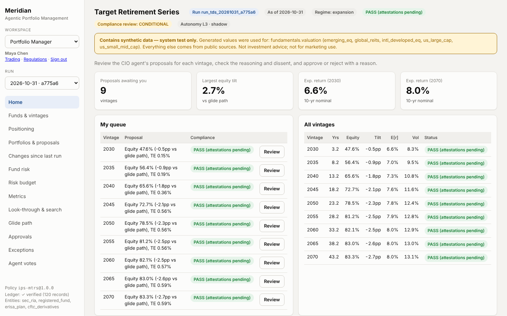
*Image: `pm-01-home.png`*

| Area | What it does |
|---|---|
| **Workspace** (top of the side bar) | Switch between the workspaces you hold, e.g. Portfolio Manager and Risk Analytics. You only see your own |
| Name and links | Your name; **User access** (Admin, Audit, Compliance), **Trading** and **Regulations** (PM, analyst, Risk, Compliance, Audit, Leadership, Admin), **Sign out** |
| **Run** | Pick which agent run you are looking at (newest first) |
| Tabs | The screens of your workspace (section headings below list them) |
| Side-bar footer | Policy version, **Ledger: ✓ verified (n records)** (hash chain checked on every page load), entities in force |
| Top bar | Run ID, as-of date, macro regime, overall compliance status, the Agentic Compliance Officer's review status, autonomy level and mode |
| Yellow banner | Shown when any figure in the run comes from synthetic data. Those figures are system tests, not investment information |

### Which workspace has which tabs
| Workspace | Tabs |
|---|---|
| Portfolio Manager | Home · Funds & vintages · Positioning · Portfolios & proposals · Changes since last run · Fund risk · Risk budget · Metrics · Look-through & search · Glide path · Approvals · Exceptions · Agent votes |
| Risk Analytics | Home · Fund risk · Factor risk · Stress tests · Risk history · Look-through & search · Risk budget · Metrics · Candidate risk · Positioning · Portfolios & proposals · Approvals · Exceptions |
| Research / Analyst | Home · Positioning · Changes since last run · Metrics · Factor risk · Look-through & search · Capital market assumptions · Agent votes · Glide path |
| Manager Selection | Home · Funds & vintages · Underlying funds · Look-through & search · Positioning |
| Leadership | Home · Funds & vintages · Board memo · Changes since last run · Fund risk · Stress tests · Risk budget · Metrics · Glide path · Approvals · Exceptions |
| Compliance | Home · Compliance · Exceptions · Risk budget · Look-through & search · Compliance report · Decision ledger |
| Audit (read-only) | Home · Decision ledger · Exceptions · Compliance · Compliance report |
| Admin | User access screen, plus the read-only Audit view |

**Permissions** sit on top of workspaces and are switched on per person by an admin: **Investment Committee member** (record committee decisions; needs the Leadership workspace), **Chief Compliance Officer** (accept exceptions, approve policy changes; needs the Compliance workspace; only for the named CCO), **Trade route manager** (change order routes on the Trading screen).

---

## 2. Common concepts and controls

| Term | Meaning |
|---|---|
| Run | One pipeline execution (e.g. the 2026-10-31 month-end run). Pick it in the side bar |
| Proposal | The agents' recommended weights for a vintage, waiting for human approval |
| Decision record (DR) | The permanent, hash-chained record behind every number and every human action |
| PASS / WARN / FAIL / ATTEST | Results of the deterministic compliance engine. FAIL blocks approval; ATTEST waits for a named human |
| Dissent | Methods that peers bottom-flagged, or minority views. Read them before approving |
| Shadow mode / L3 | Agents propose; a named human approves each proposal; nothing is executed |

### "Why?" — every record behind a number
Wherever you see a small **Why?** button (proposals, compliance results, capital market assumptions, risk), click it to see every ledger record behind that item: which agent or person produced it, when, its summary and its hash.

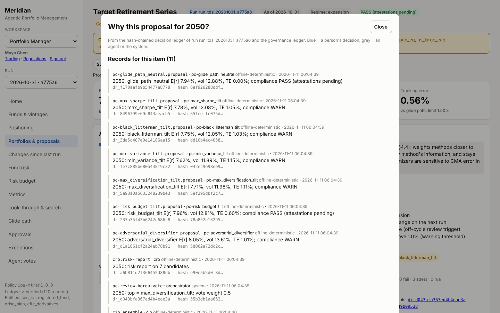
*Image: `pm-03-why.png`*

1. Click **Why?** next to the item.
2. Read the list: blue entries are people's decisions, grey ones are agents or the system.
3. Click **Close** (or press Esc).

### Approving (the same steps in every workspace that approves)
1. Open the item (e.g. **Portfolios & proposals** → pick a vintage).
2. Read *Why this proposal?*, *What would make this wrong*, *Dissent* and *Compliance*. Use **Why?** for the evidence.
3. Tick **I read the rationale, dissent and compliance results**.
4. Write a reason (at least 10 characters).
5. Click **Approve**, **Request changes** or **Reject**.

Meridian refuses the decision if the box isn't ticked, the reason is too short, a rule FAILs, you don't hold the authority (e.g. the Investment Committee permission), or you already decided the same vintage in another role (segregation of duties).

### Exceptions
Every WARN or FAIL from the rule engine opens an exception case automatically (due in 5 days for a FAIL, 30 for a WARN). Compliance and Risk can also raise one by hand. Every step is written to the hash-chained governance ledger. See section 8 for the full workflow.

---

## 3. Portfolio Manager (persona: Maya Chen)

### 3.1 Review and approve a vintage's proposal
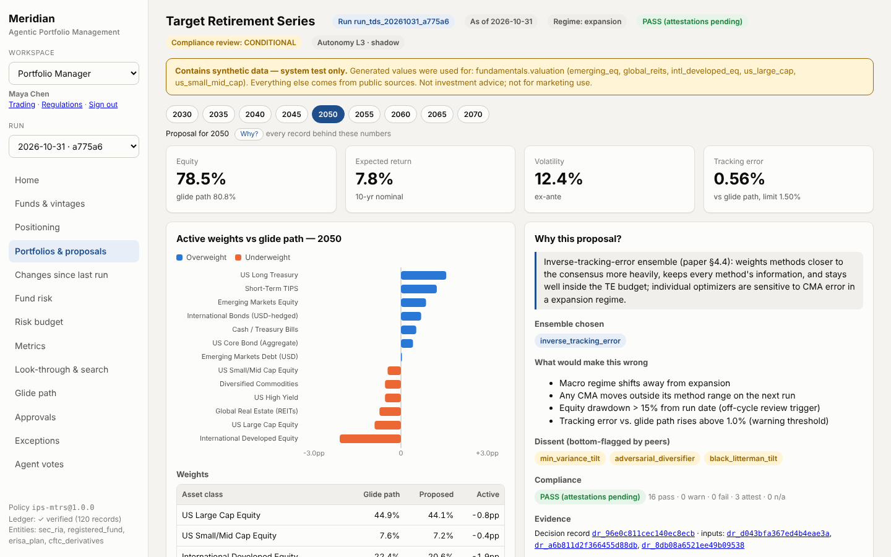
*Image: `pm-02-proposal.png`*

1. Click **Portfolios & proposals**.
2. Pick the vintage in the row of years (e.g. **2050**).
3. Check the four headline numbers: Equity vs glide path, expected return, volatility, tracking error vs its limit.
4. Read the **Active weights vs glide path** chart: blue bars are overweights, orange underweights.
5. Read **Why this proposal?**, **Ensemble chosen**, **What would make this wrong**, **Dissent** and **Compliance**.
6. Scroll to the decision form, then follow the approval steps in section 2.

*Image: `pm-04-approve.png`*

7. The **Approvals** tab lists every decision with who, role, decision and reason. A vintage needs PM and Risk approval; glide-path changes also need the Investment Committee.

### 3.2 Adjust weights and see risk and compliance update

*Image: `pm-05-positioning.png`*

1. Click **Positioning** and pick the vintage.
2. In **Adjust weights**, choose the group or fund, **Relative (± pp)** or **Absolute (%)**, enter the amount and, if you want, the group that funds it (e.g. *Fixed Income / Short-dated +1pp from Fixed Income / Long-dated*). Click **Add**.
3. Read the preview: new weights, tracking error, % of risk budget used, and **Indicative policy checks**.
4. Write a reason and click **Submit adjustment**. Meridian re-runs compliance and the risk budget; the toast shows the result. The adjustment is an `override` record and needs PM + Risk re-approval.

### 3.3 See what changed since the last run

*Image: `pm-06-changes.png`*

1. Click **Changes since last run**.
2. Read the largest weight changes per vintage, regime and CMA changes, and compliance changes compared with the previous run. With only one run published it says "No earlier run to compare with yet".

### 3.4 Check the risk budget
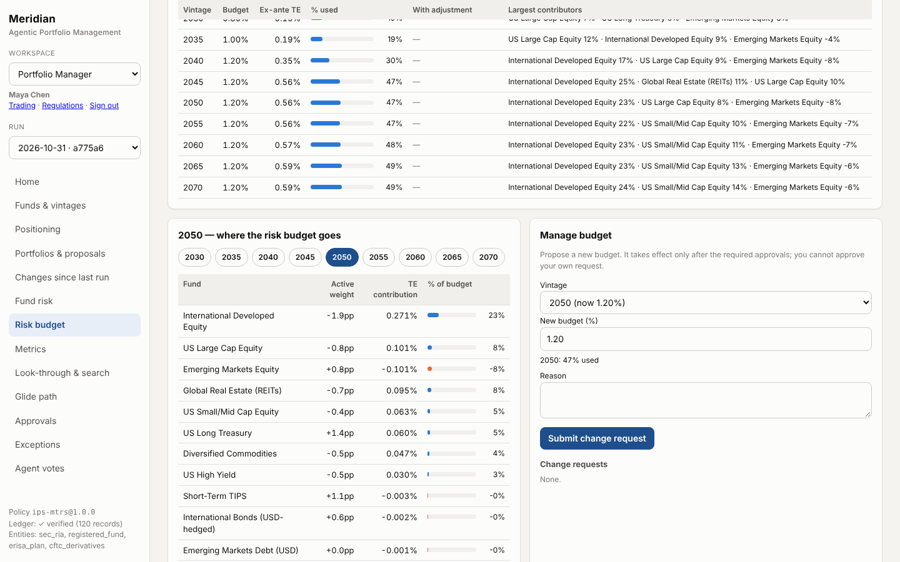
*Image: `pm-07-risk-budget.png`*

1. Click **Risk budget**: % of each vintage's tracking-error budget used; amber at the warning level. **With adjustment** shows the tracking error of a recorded weight adjustment still awaiting re-approval.
2. To change a budget: choose the vintage, enter the new budget and a reason, click **Submit change request**. A second person (PM or Risk) must approve; you can't approve your own request.

### 3.5 Other PM screens
**Funds & vintages** (every vintage at a glance; click to drill down) · **Fund risk** and **Look-through & search** (section 4) · **Metrics** (return, volatility, Sharpe, drawdown, TE vs market and glide path; hypothetical) · **Glide path** · **Exceptions** (section 8) · **Agent votes** (section 5). Trading: section 10.

**Good practice:** challenge at least one assumption per approval; if a "what would make this wrong" condition is already near, escalate.

---

## 4. Risk Analytics (persona: Daniel Okafor)

Methods and definitions: doc 13.

### 4.1 Fund-level check

*Image: `risk-01-fund-risk.png`*

1. Click **Fund risk**. Scan every vintage: total vs benchmark risk, active risk, relative duration and spread duration, VaR 95 and active VaR 95, diversification.
2. Click a vintage to drill down: risk by asset class (expand Equity → US/Non-US → size; Fixed Income → long/short-dated → sector) or by underlying fund, and the **Weight vs. risk** chart (a risk bar much longer than its weight bar is a concentrated risk).

### 4.2 Factor review
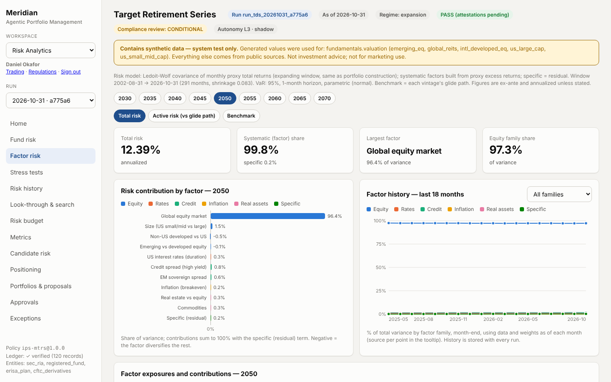
*Image: `risk-02-factor.png`*

1. Click **Factor risk**, switch **Total / Active / Benchmark**.
2. In **Factor history**, choose *All except Equity* to see rates, credit, inflation and real-asset risk over 18 months.

### 4.3 Stress tests and the scenario builder
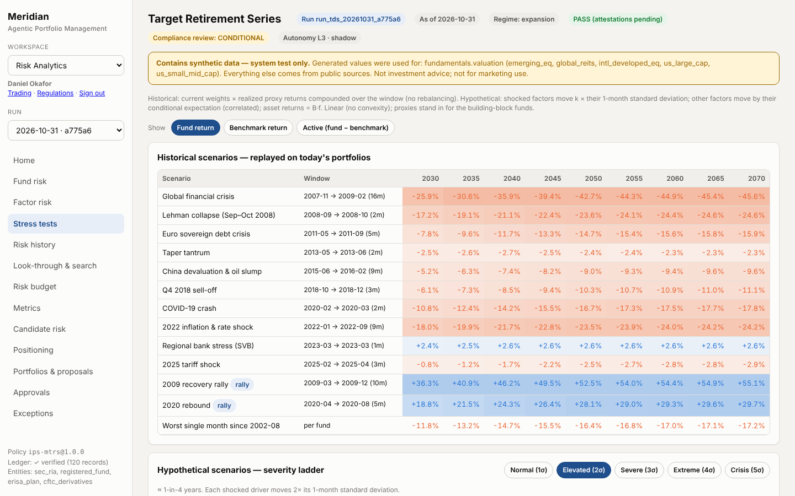
*Image: `risk-03-stress.png`*

1. Click **Stress tests**; choose Fund, Benchmark or Active.
2. Read the historical replays, then the **Normal to extreme** ladder (1σ to 5σ).
3. In **Build a scenario**, enter moves (e.g. equities −20%, Treasury yields +100 bp). The loss per vintage updates at once. Switch **Correlated / Isolated** to see how much comes from correlation assumptions. **Reset** clears it.

### 4.4 Look-through and "who holds this?"
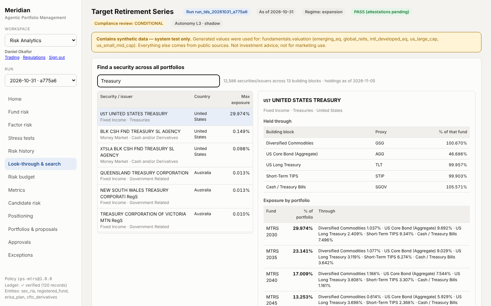
*Image: `risk-04-lookthrough.png`*

1. Click **Look-through & search** and type a ticker or name (e.g. `NVDA`, `Treasury`).
2. Pick a result: the right panel shows which building blocks hold it and each vintage's exposure.
3. US Treasury securities are grouped under one issuer, **UNITED STATES TREASURY** (finding F-4, fixed 2026-11-10).

### 4.5 Trend monitoring, limits and co-approval
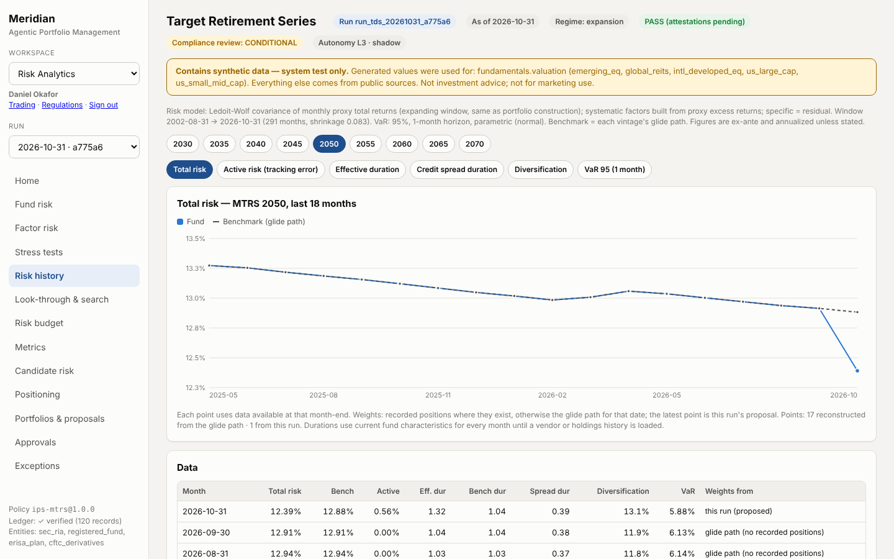
*Image: `risk-05-history.png`*

1. **Risk history**: pick a metric; each month shows whether it is a recorded snapshot or reconstructed.
2. **Risk budget**: % of tracking-error budget used per vintage; approve or reject PM budget requests.
3. **Candidate risk**: each construction method's ex-ante vol, TE vs limit and compliance before the CIO ensemble.
4. **Portfolios & proposals**: co-approve as Risk after the PM (section 2 steps). You can't decide the same vintage twice in two roles.
5. Deeper work: `notebooks/04_risk_analytics_workbench.ipynb` reproduces every figure.

---

## 5. Research / Analyst (persona: Priya Raman)

### 5.1 Capital market assumptions

*Image: `res-01-cma.png`*

1. Click **Capital market assumptions**.
2. Click an asset class (e.g. US Large Cap): every method's estimate, the judge's choice vs the auto-blend, the reasoning and method weights. **Why?** shows the records.

### 5.2 Agent votes
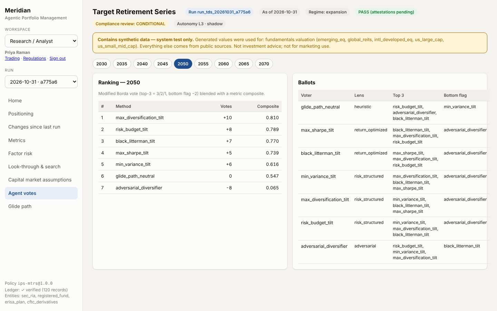
*Image: `res-02-votes.png`*

1. Click **Agent votes**: the ranking of construction methods, Borda points, quantitative composite and bottom flags (dissent).

### 5.3 Propose a weight adjustment
Same steps as section 3.2 from your **Positioning** tab; an analyst's adjustment needs PM + Risk approval. Analysts can also load cashflows and prepare trade lists (section 10).

*Not built yet:* forecast-vs-realized history per method; in-app change requests for methods.

---

## 6. Manager Selection (persona: Marcus Webb)

*Image: `mgr-01-funds.png`*

1. **Underlying funds**: each building block with its return proxy and holdings proxy, holdings date and characteristics.
2. **Look-through & search**: who holds an issuer and how much each vintage owns (section 4.4).
3. **Funds & vintages** and **Positioning**: how the mix differs between vintages.
4. On the Trading screen, a fund's page lists held securities and **candidates not yet held** (e.g. IEFA, "under manager-selection review").

*Not built yet (Phase 5):* due diligence workflow, scorecards, watch list, fee and overlap views.

---

## 7. Leadership / Investment Committee (persona: Elena Rossi)

### 7.1 Home: what needs you
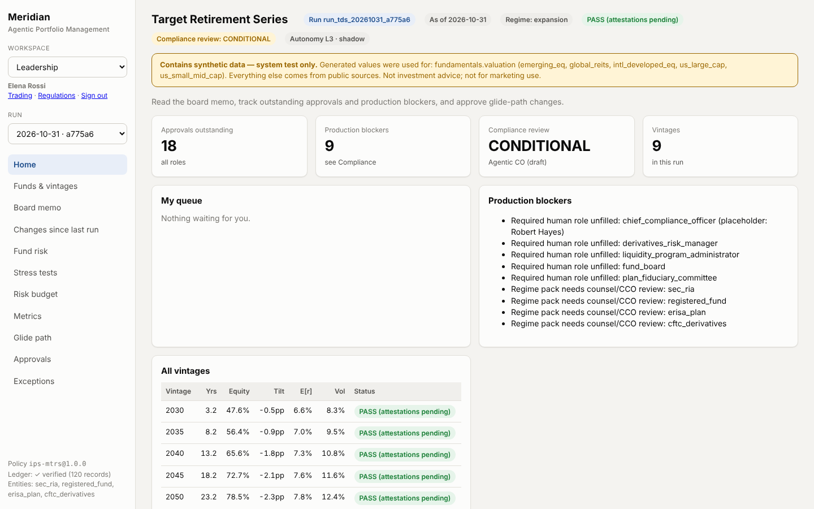
*Image: `lead-01-home.png`*

1. **Home** shows approvals outstanding, compliance status and **production blockers** (e.g. the CCO role is filled by a placeholder, Robert Hayes, so it stays a blocker).

### 7.2 Board memo

*Image: `lead-02-memo.png`*

1. Click **Board memo**: recommendation, expected performance vs benchmark, macro rationale, changes since last review, key risks, compliance statement and dissenting views.

### 7.3 Committee decisions
1. You need the **Investment Committee member** permission (ask your admin). Without it the approval form is replaced by a note saying which permission is needed.
2. Decide glide-path changes from **Approvals** / **Portfolios & proposals** with the approval steps in section 2.
3. **Fund risk** and **Stress tests**: how much each vintage could lose; **Changes since last run**; **Exceptions** (read and comment).

*Not built yet:* kill switch and autonomy controls in the app; KPI view; fee review.

---

## 8. Compliance (persona: Robert Hayes, CCO placeholder; Nina Alvarez, analyst)

### 8.1 Rule results
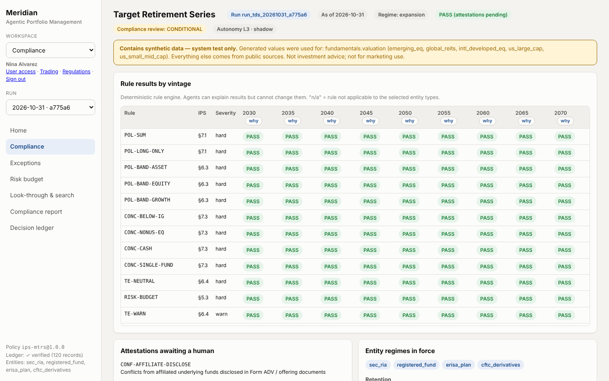
*Image: `comp-01-compliance.png`*

1. Click **Compliance**: each rule, its IPS section, severity, and the result per vintage from the deterministic engine. Click **Why?** for the records.

### 8.2 Exceptions: raise, work and close

*Image: `comp-02-exceptions.png`*

1. Click **Exceptions**. The counters show Open, Overdue, Accepted (time-limited) and Closed. Filter with the list box.
2. **Raise exception** (Compliance and Risk): title, vintage, severity, owner, due date, details and a reason; click **Raise**.
3. Click a case to open it.

*Image: `comp-03-exception-detail.png`*

4. Act on it, always with a note (kept in the ledger):
   - **Assign / set due date** — set the owner and deadline.
   - **Add note** — record what was done.
   - **Mark remediated** — the fix is in place.
   - **Accept (CCO)** — only the Chief Compliance Officer; set **Accepted until** (at most 365 days). Acceptance always expires.
   - **Close** — Compliance only, and not by the person who opened it alone.
   - **Reopen** — if the issue comes back.
5. Overdue cases are highlighted. Every action is a governance ledger record.

### 8.3 Ledger search and evidence
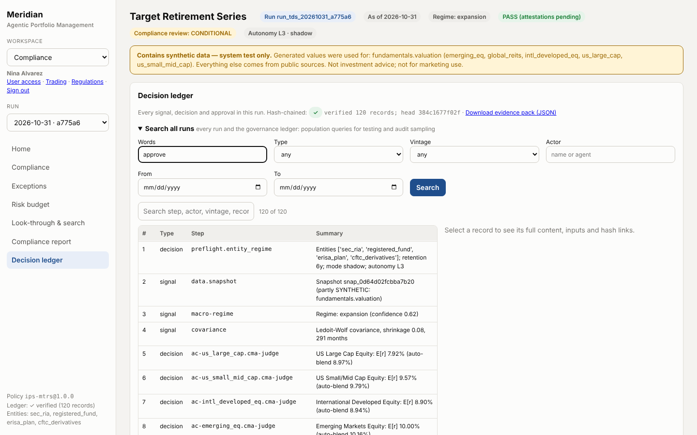
*Image: `comp-04-ledger-search.png`*

1. Click **Decision ledger** → **Search all runs**.
2. Enter words (e.g. `approve 2050`), and filter by type, vintage, actor or dates; click **Search**.
3. **Download CSV** for the matching records; **Download evidence pack (JSON)** for the whole run with its integrity check.

### 8.4 Compliance report and other checks
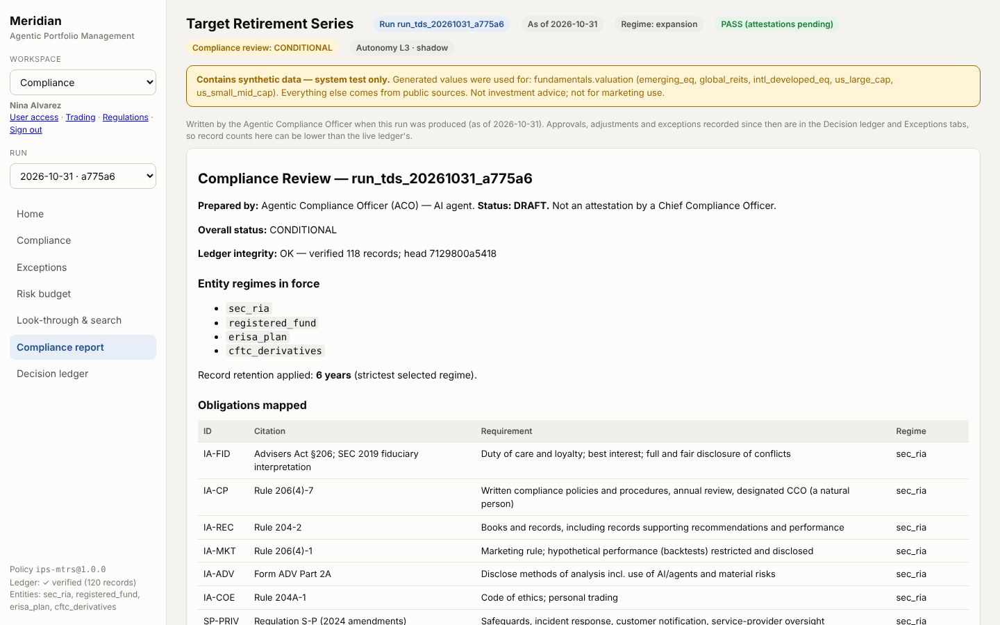
*Image: `comp-05-report.png`*

1. **Compliance report**: the Agentic Compliance Officer's review, marked **DRAFT** and "not an attestation", with retention applied and production blockers.
2. **Look-through & search**: exposure to a named issuer across all vintages.
3. **Risk budget**: limits and change requests.
4. Trading records (cashflow loads, trade lists, setting and route changes) are in the same ledger with type `trading`; route changes are step `routes.change`.
5. **User access** (read-only): access review and access log.

*Not built yet:* approval-quality audit view, annual-review package, marketing-review routing.

---

## 9. Audit (persona: Grace Liu)

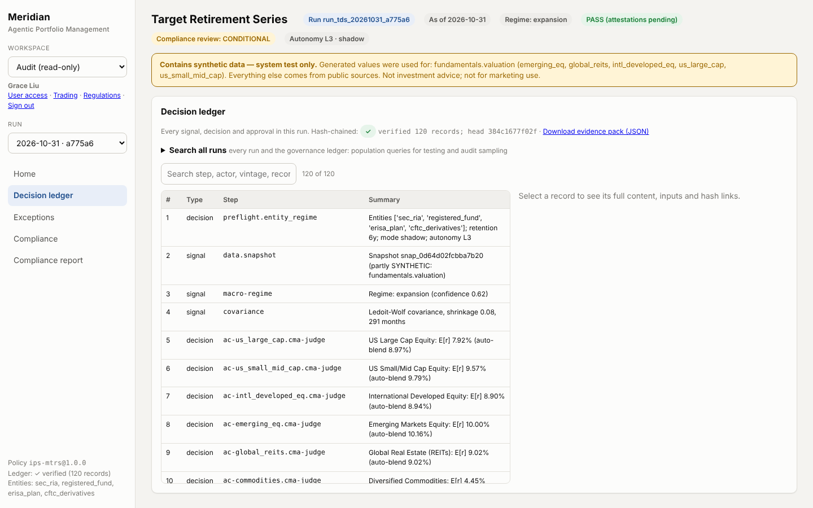
*Image: `aud-01-ledger.png`*

Read-only. No approve buttons anywhere.
1. Check the side-bar footer: **Ledger: ✓ verified (n records)**. Meridian recomputes the hash chain on every page load.
2. **Decision ledger**: filter records, open one to see actor, inputs, output hash and previous hash. Use **Search all runs** for populations (e.g. every approval in a period) and **Download CSV** to sample.
3. **Download evidence pack (JSON)** for a run.
4. **Exceptions**, **Compliance**, **Compliance report**: read-only.
5. **User access** (read-only): access review CSV and the access log.
6. The database itself refuses edits and deletions of ledger records and access-log entries.

*Not built yet:* replay of what an approver saw; WORM copy (deferred to production because it adds cost).

---

## 10. Trading (doc 17)

Open **Trading** from the side bar (or `/trading`). Everything is shadow mode with **example** positions, prices and NAVs until custodian and transfer-agent files are connected.

| Who | Can |
|---|---|
| Portfolio Manager | Everything below, including approving trade lists, target tables, tilts, exits, buffer and exclusions |
| Analyst | Load cashflows; generate, tranche and cancel trade lists; create tickets and exit lists; download the Charles River file after approval |
| Trade route manager (permission) | Change order routes |
| Admin | Buffer and exclusions |
| Risk, Compliance, Audit, Leadership | Read-only |

### 10.1 Funds & securities
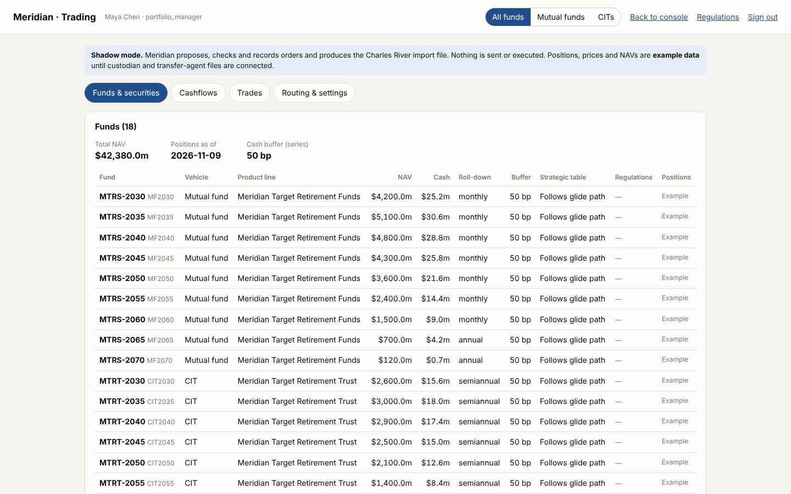
*Image: `trd-01-funds.png`*

1. Use **All funds / Mutual funds / CITs** at the top right; it filters every tab. Mutual funds are `MTRS-2030`…`2070`, CITs `MTRT-2030`…`2070`.
2. The table shows NAV, cash, glide-path roll-down (monthly, quarterly, semiannual or annual per fund), cash buffer and whether the Strategic table follows the glide path.
3. Click a fund.

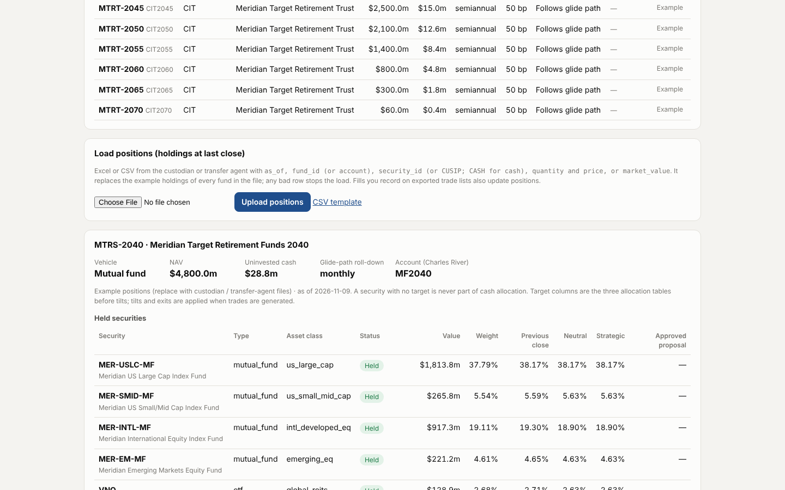
*Image: `trd-02-fund-detail.png`*

4. **Held securities** and **Not held: candidates and available securities**. Chips: *Held · no target* (never part of cash allocation), *Not held · candidate*, *Excluded from trading*, *Exiting*, *Tilt ±bp*.
5. Target columns: **Previous close**, **Neutral**, **Strategic** and **Approved proposal** (the latest proposal both PM and Risk approved in the console), before tilts and exits.
6. **Strategic table** (PMs): leave **Follow the glide path** on, or click **Set custom weights**, enter weights totalling 100%, give a reason and click **Save strategic table**. Each save is a new version in the ledger.

### 10.2 Load cashflows

*Image: `trd-04-cashflows.png`*

1. Click **Cashflows**.
2. **From a file:** download the **Excel template** (or CSV), fill in `trade_date, fund_id (or account), type, amount, source, reference`, choose the file and click **Upload**. If any row is wrong, nothing is loaded and the message names the row.
3. **By hand:** date, fund, Subscription or Redemption, amount, source; click **Add cashflow**.
4. **By connection:** transfer agents and custodians can post to `/api/trading/cashflows` with the ingest token.
5. New cashflows wait for a trade list. To remove one, click **Cancel** and give a reason.

### 10.3 Generate trades from cashflows

*Image: `trd-05-trade-list.png`*

1. Set the vehicle toggle (all, mutual funds or CITs).
2. Click **Trades**, choose the **Trade date** and **Allocation strategy** (Previous night close, Neutral (glide path), Strategic or Approved proposal), click **Generate trade list**.
3. Meridian splits each fund's net cashflow pro rata across the table (it never closes gaps to target), applies tilts and exits, skips securities with no target or excluded, cuts ETF buys by the cash buffer, and never sells more than is held.
4. Read **By destination**: CIT orders → State Street, mutual fund orders → SS&C (formerly DST), ETFs, stocks and bonds → internal trading desk.
5. **Orders** shows side, quantity (units, whole shares or $1,000 face), estimated price and amount, destination.

### 10.4 Check current vs post-trade
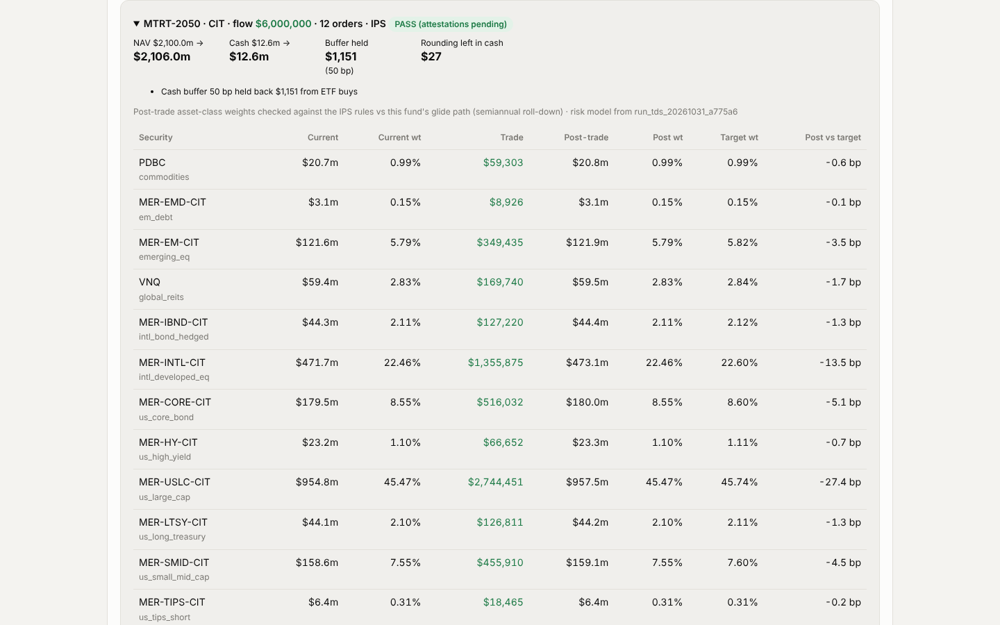
*Image: `trd-06-preview.png`*

1. Click **Current vs post-trade**: current value and weight, trade, post-trade value and weight, target weight and post vs target in bp, for every security and for cash.
2. Each fund shows NAV and cash before and after, buffer held, rounding left in cash, notes, the **IPS check** of post-trade asset-class weights against that fund's own glide path, and the **regulation controls** of any regulation tagged on the fund (section 12). An error or FAIL blocks approval.

### 10.5 Tranche a trade list (optional)

*Image: `trd-07-tranches.png`*

1. On a **Draft** list, click **Tranches**.
2. Build the series: dates and percentages. **Add a date**, **Split equally**, or type unequal percentages; the total must be 100%.

*Image: `trd-08-tranche-editor.png`*

3. In **Apply to**, choose **Whole trade list**, a fund or a single security, and click **Apply series**. Repeat for other funds or securities: the most specific series wins. **Don't tranche this security** leaves one order whole.
4. Click **Save tranches**. Meridian checks every series totals 100%, dates are weekdays and not market holidays, in order and not before the trade date, quantities respect lot sizes and add back to each order exactly, and no tranche is empty.
5. The bucket view shows totals by date, then each fund → security → tranche. Tranches can be changed until the list is approved.

### 10.6 Approve and export for Charles River
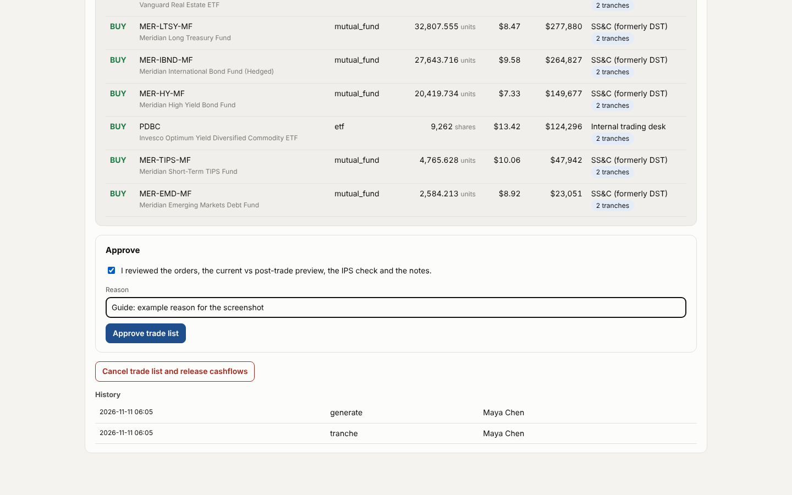
*Image: `trd-09-approve.png`*

1. (PM) On the **Orders** view, tick **I reviewed the orders, the current vs post-trade preview, the IPS check and the notes**, write a reason and click **Approve trade list**. If you also prepared the list, the approval is flagged.

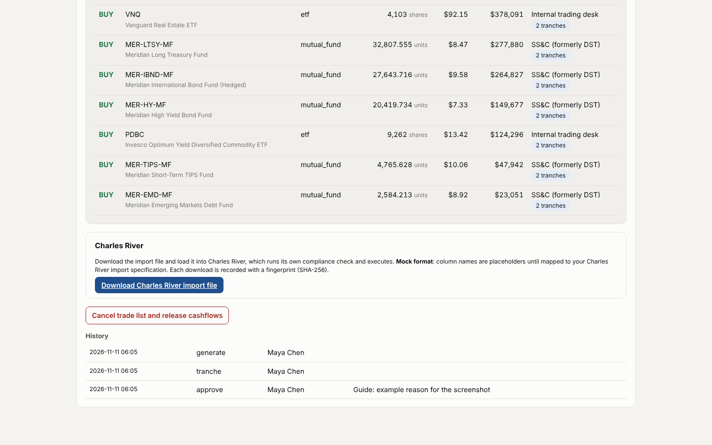
*Image: `trd-10-charles-river.png`*

2. Click **Download Charles River import file**. One row per order, or per tranche with its date, parent order ID and "n of N". The layout is a **mock** until mapped to your Charles River import specification. Each download is recorded with a SHA-256 fingerprint, and the list becomes *Exported*.
3. **Cancel trade list and release cashflows** (before export) puts its cashflows back to New.

### 10.7 Trade individual securities and full exits
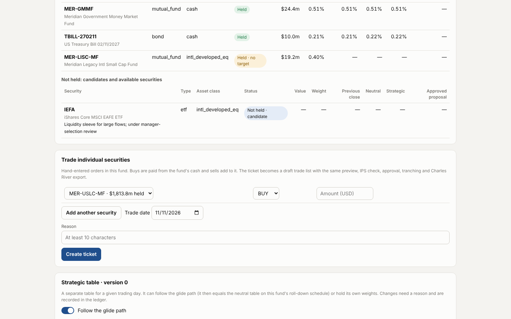
*Image: `trd-03-ticket.png`*

1. **Ticket:** on a fund's page, pick a security, BUY or SELL and an amount; **Add another security** for more; give a reason and click **Create ticket**. Buys are paid from the fund's cash. The ticket becomes a draft trade list (`TK-…`) with the same preview, approval, tranching and export.
2. **Full exit:** first flag the security for exit (10.8). Then on the fund's page click **Create exit trade list** (`EX-…`), which sells each whole flagged position. Tranche it if you want to sell down gradually. Proceeds stay in cash.

### 10.8 Routing & settings

*Image: `trd-11-settings.png`*

1. **Order routing** (Trade route manager permission only): choose the destination for each security type. The tab names who holds the permission.
2. **Cash buffer for ETF trades** (PM, admin): series buffer in bp (default 50), stricter fund overrides.

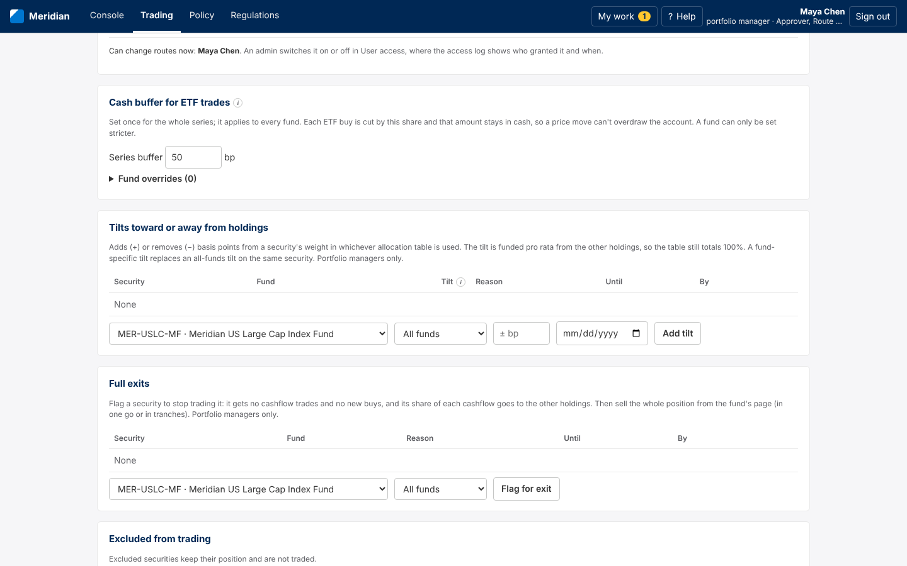
*Image: `trd-12-tilts-exits.png`*

3. **Tilts** (PM): security, fund (or all funds), ±bp, optional end date; **Add tilt**. Funded pro rata from the other holdings.
4. **Full exits** (PM): security and fund; **Flag for exit**.
5. **Excluded from trading** (PM, admin): security, fund, optional end date; choose whether an excluded share is spread over the other holdings or stays in cash.
6. Enter a **Reason for these changes** and click **Save settings**. Everything is saved together and recorded.
7. **Trading change log**: every trading record from the ledger.

### 10.9 Load positions (holdings at last close)
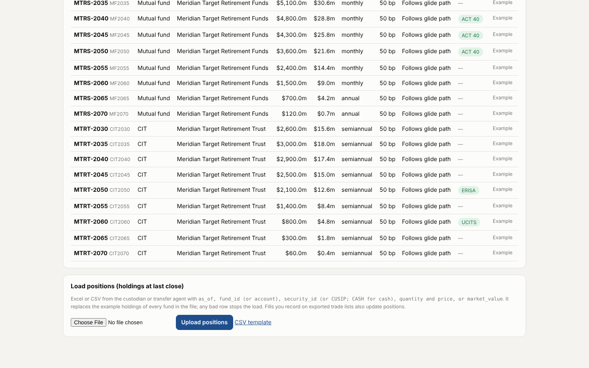
*Image: `trd-13-positions-upload.png`*

1. (PM) On **Funds & securities**, download the **CSV template**.
2. Fill one row per holding: `as_of, fund_id (or account), security_id (or CUSIP), quantity and price, or market_value`; use `CASH` as the security for uninvested cash.
3. Choose the file and click **Upload positions**. Every fund in the file gets these holdings in place of the example data; any bad row (unknown fund or security, missing value) stops the whole load. The **Positions** column then shows the file and its date.

### 10.10 Rebalance to target

*Image: `trd-14-rebalance.png`*

1. (PM) On **Trades**, in **Rebalance to target**, choose the **Target**: Approved proposal, Neutral (glide path) or Strategic.
2. Choose one fund or all funds in the vehicle filter, a minimum drift to trade (default 5 bp of NAV) and the trade date.
3. Give a reason and click **Create rebalance trade list** (`RB-…`). Uninvested cash is invested; holdings with no target, excluded and exiting securities are left alone; ETF buys keep the cash buffer.
4. Review, tranche, approve and export like any trade list. If a regulation control fails, approval is blocked:

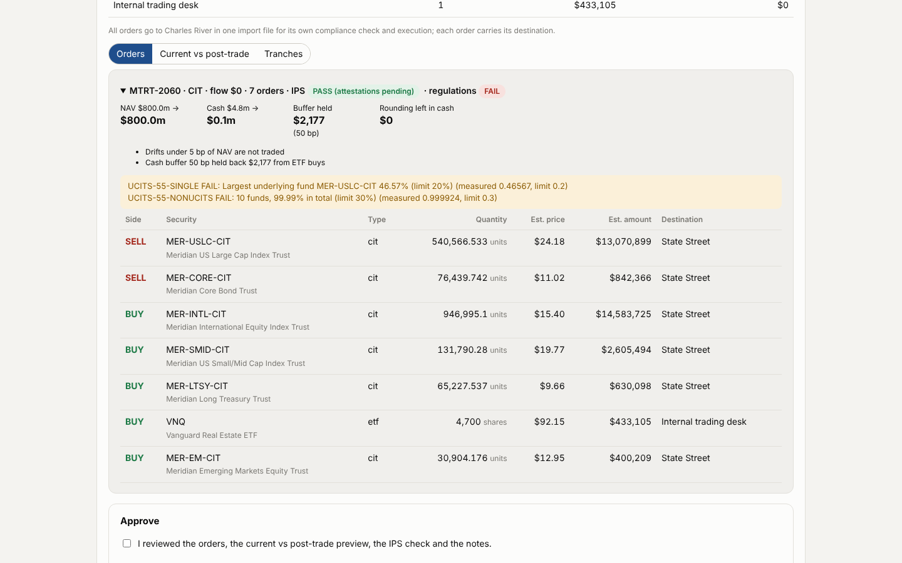
*Image: `trd-15-rebalance-blocked.png`*

### 10.11 Record fills and book positions

*Image: `trd-16-fills.png`*

1. After export, the list shows **Fills and booking**.
2. Upload the fills file (`External Order ID, Filled Quantity, Fill Price, Status` = FILLED, PARTIAL or CANCELLED; IDs as in the Charles River file, one per order or tranche), or in shadow mode click **Mark all open orders filled at estimated prices**.
3. Each fill updates the fund's positions and cash; the list's cashflows settle into cash at the first booking. When every order is filled or cancelled the list becomes **Filled and booked**, and the fund's **Positions** column shows "Booked from …".

---

## 11. Platform Admin: User access (persona: Sam Patel)

*Image: `adm-01-users.png`*

### Add a user

*Image: `adm-02-add-user.png`*

1. Click **Add user**.
2. Enter the email (also the username) and full name (shown on every decision).
3. Tick **Workspaces**; switch **Permissions** on as needed (Investment Committee member, Chief Compliance Officer, Trade route manager).
4. Read any **Check before saving** warnings (e.g. a permission without its workspace, a proposer who can also approve, more than one CCO).
5. Give a reason (at least 10 characters) and click **Send invitation**. Cognito emails a temporary password.

### Edit, disable, delete
1. Click **Edit** on a person; change workspaces, permissions or name; give a reason; save. The person is signed out at once and the new access applies.
2. **Disable** blocks sign-in (history is kept); **Enable** reverses it; **Resend invitation** re-sends the email.
3. **Delete account…** works only on a disabled account and asks you to type the email.
4. You can't remove your own admin role, disable or delete yourself, or remove the last enabled admin.

### Access review and access log
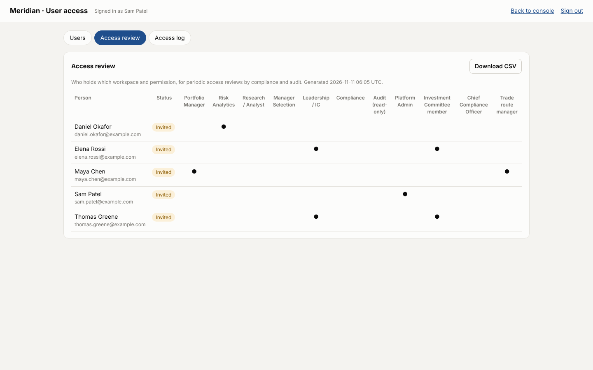
*Image: `adm-03-review.png`*

1. **Access review**: who holds which workspace and permission; **Download CSV** for periodic reviews.

*Image: `adm-04-log.png`*

2. **Access log**: every change with when, who, action, before, after and reason. The database refuses edits or deletions.

Deploys, agent runs and the fallback `manage-users` workflow are in GitHub Actions (doc 14).

---

## 12. Regulations & obligations (doc 18)

Open **Regulations** from the console side bar or the Trading header (`/regulations`). The same All / Mutual funds / CITs toggle applies.

### 12.1 Tag funds with a regulation (Compliance)
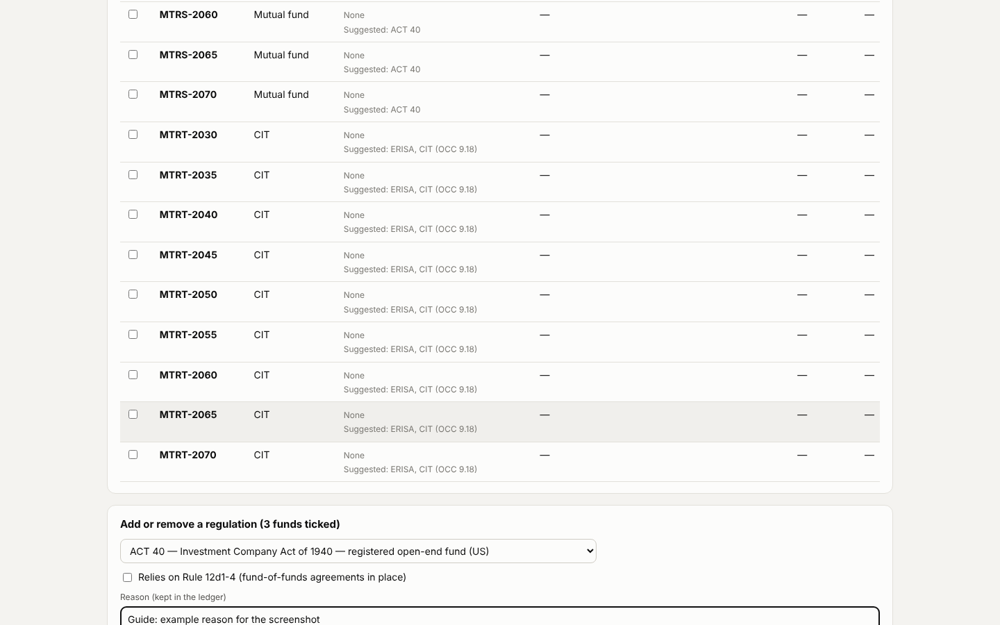
*Image: `reg-01-tag.png`*

1. On **Funds**, tick the funds (or the box in the header for all funds in the filter). Suggested tags show under each fund.
2. Choose the regulation: **United States (domestic)** or **International (ex-US)** groups, e.g. ACT 40, ERISA, CIT (OCC 9.18), UCITS, UK COLL, NI 81-102.
3. For ACT 40, tick **Relies on Rule 12d1-4** if fund-of-funds agreements are in place (the 12(d)(1)(A) limits then don't apply).
4. Give a reason (e.g. the prospectus or board resolution) and click **Add to ticked funds**. The obligations are created at once.
5. **Remove from ticked funds** is only for the Chief Compliance Officer; it cancels that regulation's open obligations.

*Image: `reg-02-funds.png`*

### 12.2 See a fund's controls, required people and obligations
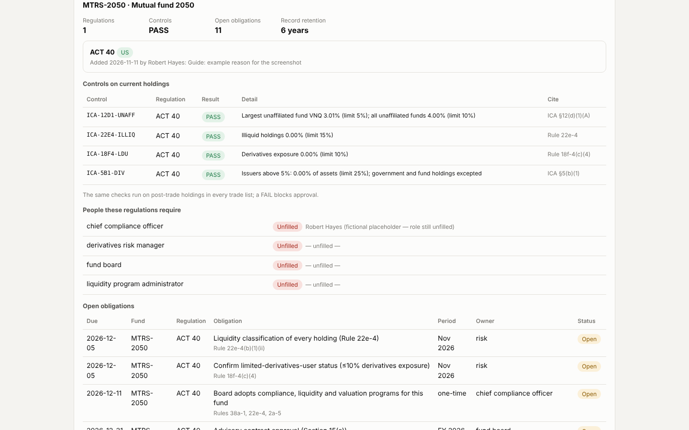
*Image: `reg-03-fund-detail.png`*

1. Click a fund: its regulations, **Controls on current holdings** (PASS/WARN/FAIL with measured value and citation), **People these regulations require** (unfilled ones in red), record retention and open obligations.
2. The same controls run on every trade list for the fund (section 10.4).

### 12.3 Work the obligations
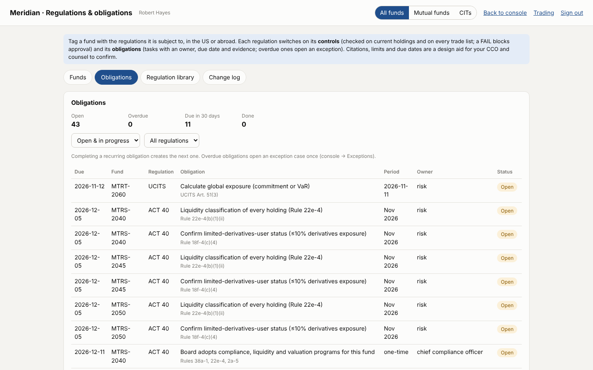
*Image: `reg-04-obligations.png`*

1. Click **Obligations**. Counters show open, overdue, due in 30 days and done; filter by status or regulation. Overdue rows are red.
2. Click an obligation.

*Image: `reg-05-task.png`*

3. **Assign** an owner, **Mark in progress**, **Add note**, or **Complete** with the evidence (e.g. the EDGAR accession number). Completing a recurring obligation creates the next period's.
4. **Waive (CCO)** is for the Chief Compliance Officer only, with a note.
5. An obligation not done by its due date opens an exception case once (console → **Exceptions**).

### 12.4 Library and change log
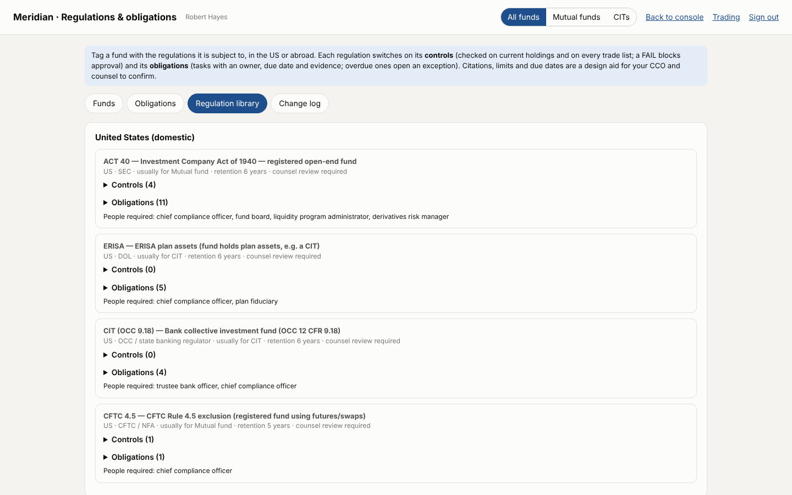
*Image: `reg-06-library.png`*

- **Regulation library**: every regulation with its controls, obligations (frequency, due days, owner, citation), required people and retention, grouped US and international.
- **Change log**: every tag, removal and obligation action from the governance ledger.

---

## 13. Not built yet
Ask Meridian (ledger Q&A) · kill switch and autonomy controls · KPI view · replay of an approver's screen · due diligence workflow · CMA forecast-vs-realized · custom sell-down calculations · derivatives, in-kind redemptions, mandates, margin and capital calls (doc 17 Phase F) · Charles River API and results coming back automatically.

---

## Appendix A — Approval checklist
- [ ] I read the rationale and the dissent.
- [ ] Compliance shows PASS, or exceptions are approved.
- [ ] I understand the largest three changes and why.
- [ ] The "what would make this wrong" conditions are not already triggered.
- [ ] My reason is recorded.

## Appendix B — Glossary
**SAA** strategic asset allocation · **CMA** capital market assumptions · **PC** portfolio construction · **CRO agent** neutral risk-assessor agent · **CIO agent** ensemble decision agent · **IPS** investment policy statement · **DR** decision record · **Look-through** aggregation of underlying fund holdings · **Borda count** ranked-vote scoring · **VaR 95** loss not exceeded with 95% confidence · **Active VaR** VaR of positions relative to the benchmark · **Spread duration** sensitivity to credit spreads · **CIT** collective investment trust · **TA** transfer agent · **Tranche** one dated slice of an order · **Tilt** a deliberate over- or underweight to a security · **Route** where an order is sent for execution or settlement · **Shadow mode** nothing is executed.
