# 06 — User Guides by Role

**Version 0.9 · 2026-11-13 (Approver permission; vintage picker; Proposals tab) · Applies to: the hosted Meridian pilot (https://d3maw6l4k5cc0v.cloudfront.net). Everything in this guide is built and live unless it is marked *Not built yet*.**

**About the screenshots.** They were taken from a local copy of the app signed in as the fictional people in the persona roster (doc 15), on the offline example run and the example trading data. Numbers, run IDs and dates in your app will differ. Image files: `docs/img/guide/` in the repository (regenerate with `MERIDIAN_OFFLINE=1 pytest tests/e2e/guide_screenshots.py`). Illustrated copy with every screenshot: https://claude.ai/artifact/VtD4preFCa4NvY65h9sUTU (this Project copy carries the image names in place of the pictures).

**Shadow mode.** Meridian is in shadow mode: no money moves. Approvals and trade lists are real records in the ledger, but nothing is sent to Charles River, a transfer agent, a custodian or the trading desk.

## How to use this guide
Every task below follows the same pattern, so you can follow it with no prior knowledge:

- **Who** can do it and **where** it is (the screen, then the tab).
- **Before you start**: anything that must already be true.
- **Steps**: numbered. Do them in order. Words in **bold** are exactly what you will see on screen (a button, tab or heading).
- **You're done when**: what you should see at the end, so you know it worked.
- **If something goes wrong**: the common messages and what to do.

Not sure where to start? Use this table.

| I want to… | Go to |
|---|---|
| Sign in for the first time | 1.1 |
| See what is waiting for me | 1.3 |
| Approve a vintage's proposal | 3.2 |
| Change a vintage's weights | 3.3 |
| Change the glide path for a set of funds | 3.6 |
| Check or change the risk budget | 3.5 |
| Invest today's cashflows (keep the current mix, back to the glide path, strategic) | 10.3 |
| Get funds back to the glide path, a strategic mix or the approved proposal | 10.4 |
| Buy or sell a specific stock, bond, ETF or fund | 10.5 |
| Sell a position completely | 10.6 |
| See what my trades would do before saving them | 10.7 |
| Approve a trade list and export it to Charles River | 10.9 |
| Raise or close an exception | 8.2 |
| Add a user | 11.1 |
| Tag a fund with a regulation | 12.1 |

## Contents
1. Signing in and finding your way around
2. Common concepts and controls
3. Portfolio Manager
4. Risk Analytics
5. Research / Analyst
6. Manager Selection
7. Leadership / Investment Committee
8. Compliance
9. Audit
10. Trading (PMs, analysts; read-only for Risk, Compliance, Audit, Leadership, Admin)
11. Platform Admin: User access
12. Regulations & obligations
13. Not built yet
Appendix A: Approval checklist · Appendix B: Glossary · Appendix C: Messages and what they mean

---

## 1. Signing in and finding your way around

### 1.1 Sign in for the first time
**Who:** everyone. **Before you start:** your admin has added you (section 11) and you have the email from Amazon Cognito with your username (your email) and a temporary password.

1. Open https://d3maw6l4k5cc0v.cloudfront.net in Chrome, Edge or Safari.
2. Click **Sign in**.
3. Type your email and the temporary password from the email. Click **Sign in**.
4. Choose your own password: at least 12 characters, including a symbol. Type it twice and confirm.
5. You land on your workspace's **Home** page. (Admins with no other role land on **User access**.)

**You're done when** you see your name at the top right of the dark bar.

**If something goes wrong**
| Problem | What to do |
|---|---|
| The temporary password doesn't work | It expires after 7 days. Ask your admin to click **Resend invitation** (section 11.2) |
| You forgot your password | On the sign-in page click **Forgot your password?**; a code is sent to your email |
| You see a workspace you don't expect, or miss one | Ask your admin; access is set per person in **User access** |

**Good to know.** Sessions last 8 hours. Never share your login: every approval is recorded against the signed-in person. If your access changes, Meridian signs you out at once and you sign in again with the new access. MFA can be added with an authenticator app; it will become mandatory for approvers and admins (doc 03 backlog).

### 1.2 Getting around: the app bar
Every screen has the same dark bar across the top.

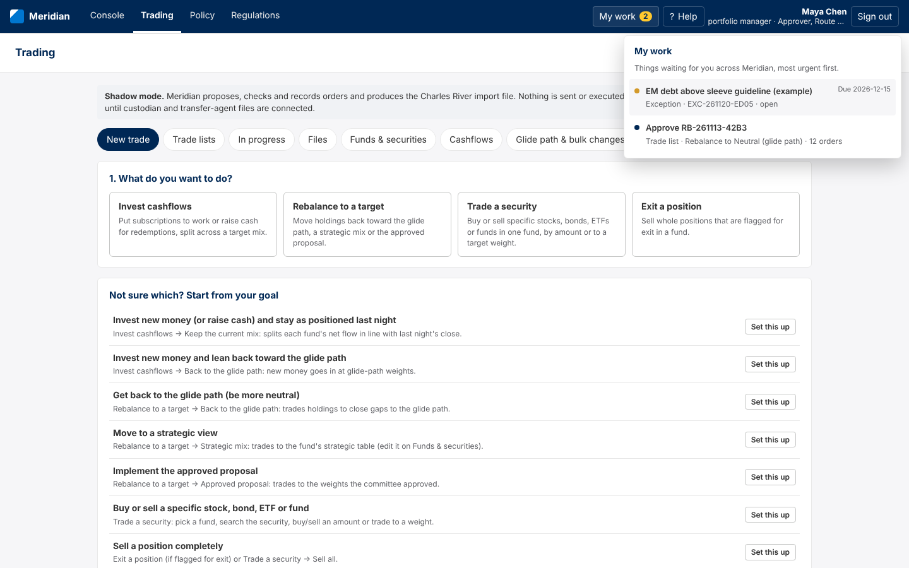
*Image: `nav-01-my-work.png`*

| Part of the bar | What it does |
|---|---|
| **Meridian** | Back to the console home |
| **Console · Trading · Regulations · User access** | The screens you can use. You only see the ones your access allows; the one you are on is underlined |
| **My work (n)** | Everything waiting for you, across all screens (1.3). Amber when something is due, red when overdue |
| **? Help** | Opens this guide inside Meridian at the section for the screen you are on (1.5) |
| Your name and access | Your workspaces, plus any permissions (Investment Committee, CCO, Route manager, Approver) |
| **Sign out** | Ends your session |

Under the bar, each screen has its own title. On **Trading** and **Regulations** the **All funds / Mutual funds / CITs** switch sits at the right and filters every tab. A **Read-only** label shows there when you can look but not change things.

### 1.3 See what is waiting for you (My work)
**Who:** everyone. **Where:** the dark bar, any screen.

1. Click **My work**. A list opens, most urgent first.
2. Read each line: what is waiting, where, and when it is due. You see trade lists to approve (PMs with the Approver permission) or to record fills for, glide-path changes for the Investment Committee (never your own request), regulatory obligations due within 14 days or overdue for your role, and exceptions you own (Compliance also sees every overdue exception).
3. Click a line. Meridian opens the right screen with that item already selected (for example the trade list on **Trading → Trade lists**).
4. To close the list without choosing, press **Esc** or click anywhere else.

**You're done when** the item is open on its own screen.

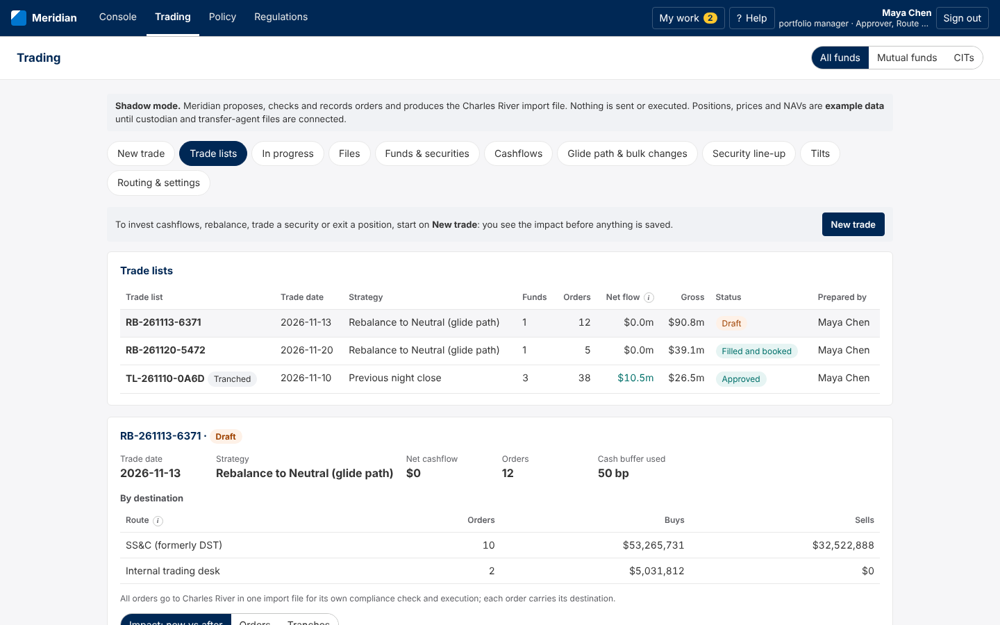
*Image: `nav-02-from-my-work.png`*

The count refreshes every minute and whenever you come back to the browser tab.

### 1.4 The console layout

*Image: `pm-01-home.png`*

| Area | What it does |
|---|---|
| **Workspace** (top of the left side bar) | Switch between the workspaces you hold, e.g. Portfolio Manager and Risk Analytics |
| **Run** | Pick which agent run you are looking at (newest first). Everything on the page follows this choice |
| Tabs, under **Overview**, **Portfolio**, **Risk**, **Governance** | The screens of your workspace. **Exceptions** shows how many are open |
| Side-bar footer | Policy version, **Ledger: ✓ verified (n records)** (the hash chain is checked on every page load), entities in force |
| Top of the page | Run ID, as-of date, macro regime, overall compliance, the Agentic Compliance Officer's review status, autonomy level and mode |
| Yellow banner | Some figures come from synthetic data. Those figures are system tests, not investment information |

### 1.5 Get help inside Meridian
1. Click **? Help** in the dark bar. This guide opens at the section for your screen.
2. Type a word in **Search the guide** (e.g. `fills`, `glide path`). The headings narrow as you type.
3. Press **Enter** to jump to the first match.
4. Use the browser's back button to return to where you were.

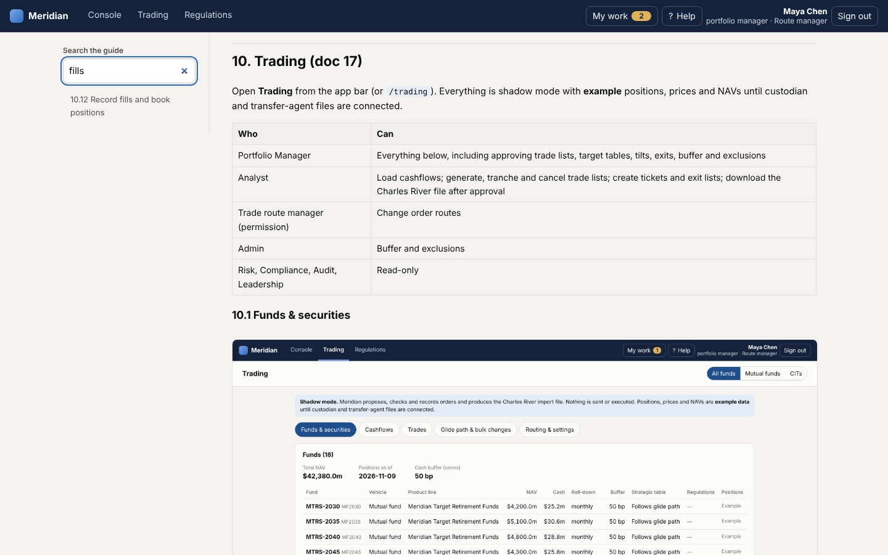
*Image: `nav-05-help.png`*

### 1.6 Messages, confirmations and reasons
- **Messages** appear at the bottom right. Green-edged ones confirm something worked and clear themselves. **Red ones are errors and stay until you close them** with **×**, so you don't miss why something was refused. Appendix C lists the common ones.
- **Confirmations.** Anything that cancels or deletes opens a box in the page saying what will happen, asking for a reason, with a red button naming the action (e.g. **Cancel trade list**). **Go back** or **Esc** leaves everything unchanged. The red button stays greyed out until the reason is long enough.
- **Reasons.** Every reason box shows a live count under it ("6/10 characters minimum", then "✓ 14 characters"). Meridian needs at least 10 characters because the reason is kept in the ledger. Write what you'd want an auditor to read, e.g. "Invest 10 Nov subscriptions at last close".
- **Working…** The button you clicked shows a spinner and can't be clicked again until Meridian answers, so nothing is submitted twice.

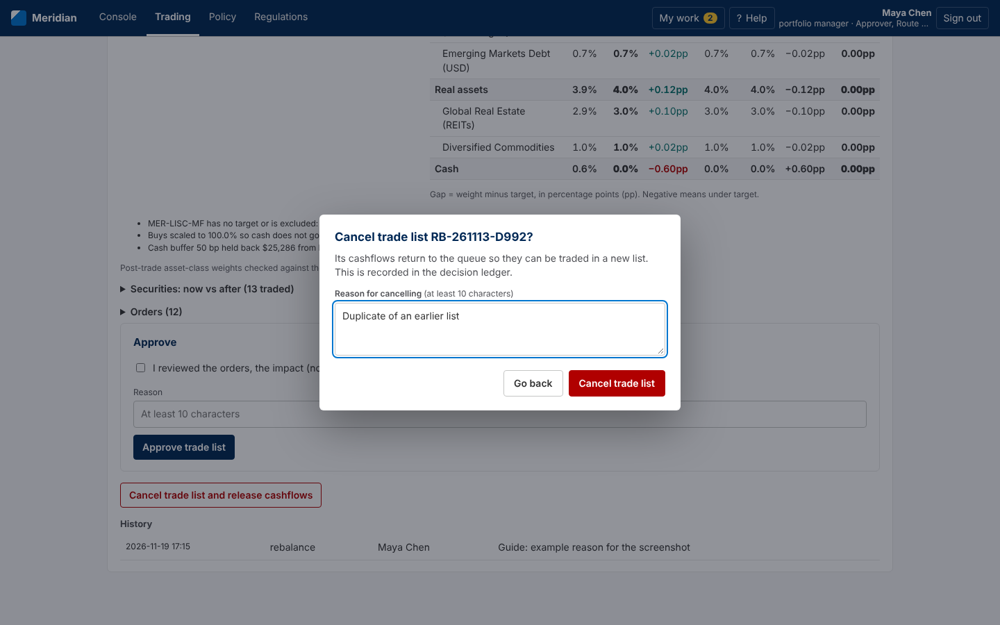
*Image: `nav-03-dialog.png`*

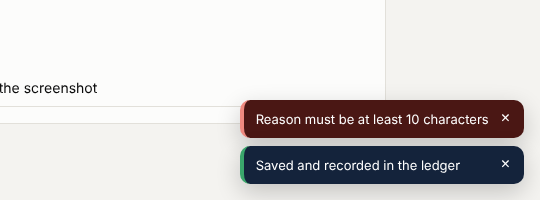
*Image: `nav-04-messages.png`*

### 1.7 If your session expires
Sessions last 8 hours. If yours ends while a page is open, your next action shows **Your session has expired**.
1. If you typed something you want to keep, click **Stay on page** and copy it first.
2. Click **Sign in** and sign in again.
3. Go back to the screen and re-enter anything that was not saved.

### 1.8 Keyboard and accessibility
- **Tab** moves through links, buttons and fields; the focused item has a blue outline. The first **Tab** on a page offers **Skip to main content**.
- In a row of tabs (e.g. Trading's **New trade · Trade lists · Funds & securities …**) use **← →** to move between tabs, **Home**/**End** for the first and last.
- **Esc** closes My work, Why? panels and confirmation boxes.
- Screen readers announce messages, and errors as alerts. Meridian follows your system's dark mode and reduced-motion settings.

### 1.9 Which workspace has which tabs
The side bar groups these under Overview, Portfolio, Risk and Governance, so the order on screen follows those headings.

| Workspace | Tabs |
|---|---|
| Portfolio Manager | Home · Funds & vintages · Positioning · Proposals · Changes since last run · Fund risk · Risk budget · Metrics · Look-through & search · Glide path · Approvals · Exceptions · Agent votes |
| Risk Analytics | Home · Fund risk · Factor risk · Stress tests · Risk history · Look-through & search · Risk budget · Metrics · Candidate risk · Positioning · Proposals · Approvals · Exceptions |
| Research / Analyst | Home · Positioning · Changes since last run · Metrics · Factor risk · Look-through & search · Capital market assumptions · Agent votes · Glide path |
| Manager Selection | Home · Funds & vintages · Underlying funds · Look-through & search · Positioning |
| Leadership | Home · Funds & vintages · Board memo · Changes since last run · Fund risk · Stress tests · Risk budget · Metrics · Glide path · Approvals · Exceptions |
| Compliance | Home · Compliance · Exceptions · Risk budget · Look-through & search · Compliance report · Decision ledger |
| Audit (read-only) | Home · Decision ledger · Exceptions · Compliance · Compliance report |
| Admin | User access screen, plus the read-only Audit view |

**Permissions** sit on top of workspaces and are switched on per person by an admin: **Investment Committee member** (record committee decisions; needs the Leadership workspace), **Chief Compliance Officer** (accept exceptions, approve policy changes; needs the Compliance workspace; only for the named CCO), **Trade route manager** (change order routes on Trading), **Approver** (record approval decisions on proposals, risk-budget changes and trade lists; works with the Portfolio Manager or Risk workspace).

**Approving needs the Approver permission.** A Portfolio Manager or Risk user without it can open and read everything, but sees *"Your account doesn't have the Approver permission"* where the decision buttons would be, and nothing waits for them in **My work** or **Approvals**. An admin switches it on or off in **User access** (11.2); every change is in the access log with who, when and why. Analysts don't approve, with or without it.

---

## 2. Common concepts and controls

| Term | Meaning |
|---|---|
| Series | The whole Target Retirement range: 9 vintages (2030–2070), each as a mutual fund (`MTRS-…`) and a CIT (`MTRT-…`), 18 funds in all |
| Product line | Mutual funds (Meridian Target Retirement Funds) or CITs (Meridian Target Retirement Trust) |
| Run | One pipeline execution (e.g. the 2026-10-31 month-end run). Pick it in the console side bar |
| Proposal | The agents' recommended weights for a vintage, waiting for human approval. Approving it does not trade |
| Glide path | The policy mix for each vintage by years to retirement (IPS). Approved adjustments can move it inside the IPS bands |
| Tilt | Proposed minus glide path, in percentage points (pp). Blue = more than the glide path, orange = less |
| Drift | What a fund holds today minus the proposal |
| Decision record (DR) | The permanent, hash-chained record behind every number and every human action |
| PASS / WARN / FAIL / ATTEST | Results of the deterministic compliance engine. FAIL blocks approval; ATTEST waits for a named human |
| Shadow mode / L3 | Agents propose; a named human approves each proposal; nothing is executed |

### 2.1 "Why?": see every record behind a number
**Where:** any small **Why?** button (proposals, compliance results, capital market assumptions, risk).

*Image: `pm-03-why.png`*

1. Click **Why?** next to the item.
2. Read the list: blue entries are people's decisions, grey ones are agents or the system. Each shows who, when, a summary and its hash.
3. Click **Close** (or press **Esc**).

### 2.2 Approving (the same steps everywhere)
**Before you start:** your account has the **Approver** permission (1.9). Without it the buttons below don't appear.

1. Open the item (e.g. **Proposals** → pick a vintage).
2. Read the summary, *Why the agents recommend it*, *What would change the view*, *Disagreement among the agents* and *Compliance*. Use **Why?** for the evidence.
3. Tick the box that starts **I reviewed…**.
4. Write a reason of at least 10 characters.
5. Click **Approve**, **Request changes** or **Reject**.

Meridian refuses the decision if the box isn't ticked, the reason is too short, a rule FAILs, you don't hold the authority (e.g. the Investment Committee permission), or you already decided the same vintage in another role (segregation of duties).

### 2.3 Exceptions
Every WARN or FAIL from the rule engine opens an exception case automatically (due in 5 days for a FAIL, 30 for a WARN). Compliance and Risk can also raise one by hand. Every step is written to the hash-chained governance ledger. Section 8.2 has the full steps.

---

## 3. Portfolio Manager (persona: Maya Chen)

### 3.1 Start your day on Home
**Where:** Console → **Home**.

1. Read the four tiles: **Assets in the series** (split mutual funds / CITs), **Proposals approved** (e.g. "0 of 9"), **Highest risk-budget use**, **Compliance**.
2. Read **Needs your attention**. Each line says what needs you; click **Open** to go straight there.
3. Scroll to **The series at a glance**: one row per vintage with mutual fund and CIT assets, glide-path equity, proposed equity, tilt, what each fund holds today, risk budget used, approval status and compliance. Click a vintage to open its proposal.

### 3.2 Review and approve a vintage's proposal
**Who:** Portfolio Manager (and Risk, as the second approver), each with the **Approver** permission. **Where:** Console → **Proposals**.
**Before you start:** the run you want is selected in **Run** in the side bar, and you hold the Approver permission (1.9).

*Image: `pm-02-proposal.png`*

1. Click **Proposals** in the side bar.
2. Under **Proposals in this run**, click the vintage (e.g. **2050**). The heading changes to **What is being approved: 2050 vintage**. It names both funds the decision covers (the mutual fund and the CIT) and says **Nothing is traded by this approval.**
3. Read **The weights**: for every asset class, the glide path, the proposed weight, the tilt and the change **Since last run**. Rows highlighted in blue move 1pp or more from the glide path.
4. Read **Tilts at a glance**: blue bars are overweights, orange underweights.
5. Read **Why the agents recommend it**, **What would change the view**, **Disagreement among the agents** (click **See how the agents voted** for detail, 5.2) and **Compliance**.
6. Optional: click **Why?** beside the decision record to see the evidence (2.1).
7. Scroll to **Your decision as Portfolio manager**.

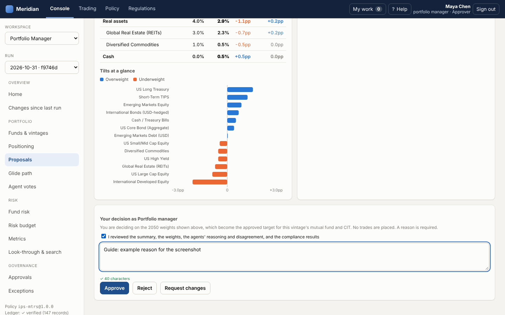
*Image: `pm-04-approve.png`*

8. Tick **I reviewed the summary, the weights, the agents' reasoning and disagreement, and the compliance results**.
9. Type a reason (at least 10 characters), e.g. "Agree with the duration tilt given the regime".
10. Click **Approve** (or **Request changes**, or **Reject**).

**You're done when** a green message confirms the decision and the vintage shows your decision. A vintage is fully approved once both the PM and Risk have approved it; the **Approvals** tab (3.7) shows who is still waiting.

**If something goes wrong:** see Appendix C ("Tick the review box", "Reason must be at least 10 characters", "Segregation of duties").

### 3.3 Change a vintage's weights and see risk and compliance update
**Who:** PM or analyst. **Where:** Console → **Positioning**.

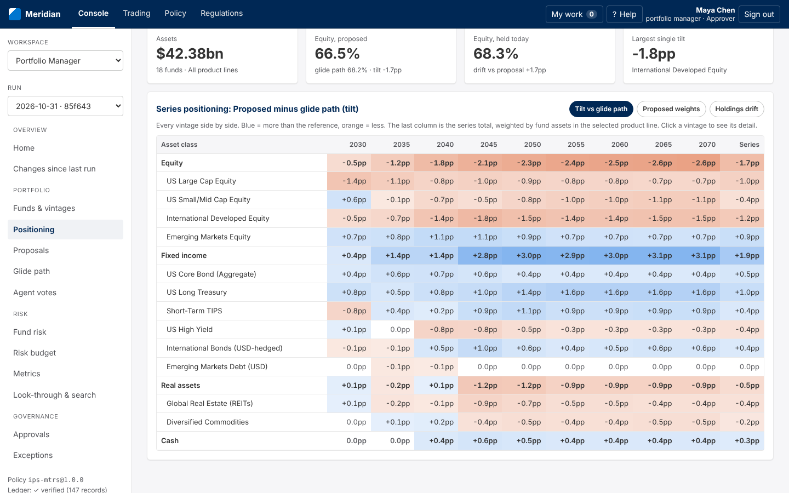
*Image: `pm-05-positioning.png`*

1. Click **Positioning**. You first see **Series positioning**: every vintage side by side, plus a **Series** column weighted by assets.
2. Use the switch at the top right of that table: **Tilt vs glide path**, **Proposed weights** or **Holdings drift** (what funds hold today minus the proposal).
3. Click a vintage's column header (e.g. **2050**) to open that vintage.

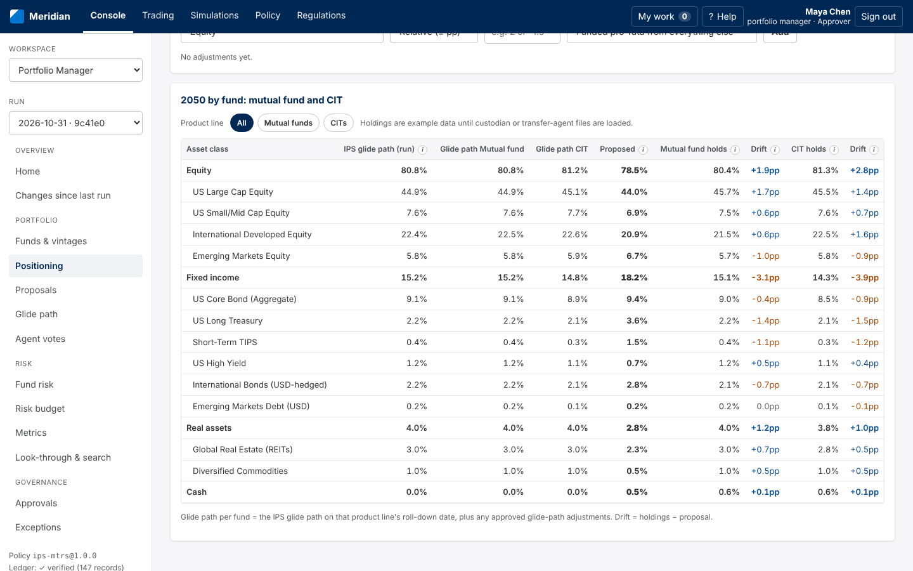
*Image: `pm-10-positioning-vintage.png`*

4. Read **2050 by fund: mutual fund and CIT**: the IPS glide path, each product line's glide path, the proposal, what each fund holds and its drift. Use **All / Mutual funds / CITs** to focus on one product line.
5. In **Adjust weights**, choose:
   - the group or asset class (e.g. **Equity** or **US Long Treasury**),
   - **Relative (± pp)** or **Absolute (%)**,
   - the amount (e.g. `1` or `-0.5`),
   - how it is funded (default **Funded pro-rata from everything else**, or a named group).
6. Click **Add**. Add more moves if you need them.
7. Read the preview: new weights, tracking error, % of risk budget used and **Indicative policy checks**.
8. Under **Submit for approval**, type a reason and click **Submit adjustment**.

**You're done when** the green message says the adjustment was recorded. Meridian re-runs compliance and the risk budget; the adjustment is an `override` record and needs PM and Risk to approve it again (3.2).

### 3.4 See what changed since the last run
1. Click **Changes since last run**.
2. Read the largest weight changes per vintage, regime and CMA changes, and compliance changes compared with the previous run. With only one run published it says "No earlier run to compare with yet".

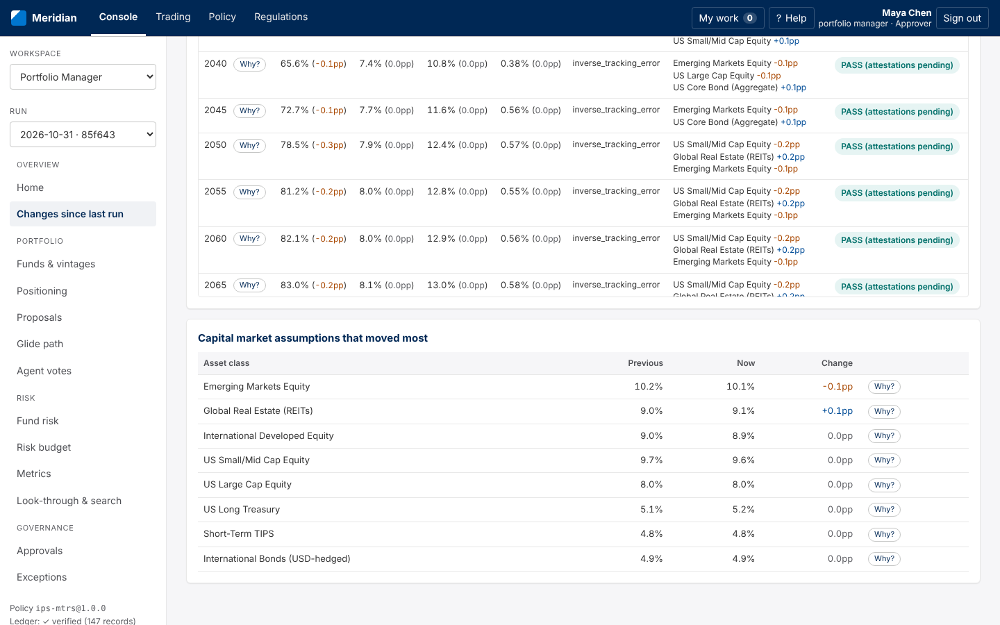
*Image: `pm-06-changes.png`*

### 3.5 Check the risk budget, then use less of it or change it
**Where:** Console → **Risk budget**.

*Image: `pm-07-risk-budget.png`*

**Read it**
1. Click **Risk budget**. **Risk budget used across the series** shows one bar per vintage: the % of its tracking-error budget used, the tracking error against the limit (e.g. "0.56% of 1.20%") and **OK** or a warning. The dotted line is the warning level, the solid line the limit.
2. **Where the budget goes, across the series** shows which asset classes use the budget in each vintage. Negative values reduce active risk.

**Use less (or more) of the budget: change the weights**
3. Under **Changing how much risk is used**, click **Adjust 2050 weights** (the button names the vintage). This opens Positioning; follow 3.3.

**Change the budget itself (a policy change; needs two approvals)**
4. Scroll to **Request a budget change**.
5. **1. Which budget**: choose the vintage.
6. **2. New budget (tracking error, %)**: type the new limit (e.g. `0.30`).

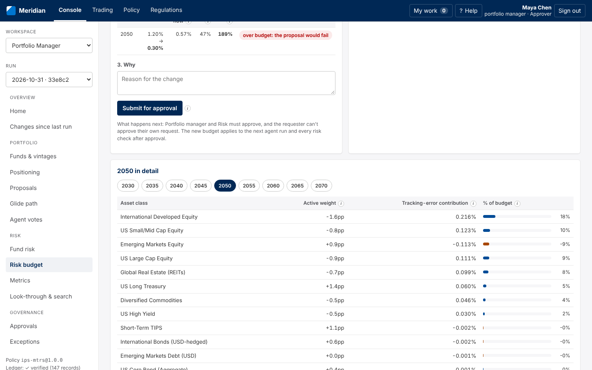
*Image: `pm-11-risk-budget-preview.png`*

7. Read the preview: the budget used today against the new limit, and whether the vintage would be over budget.
8. **3. Why**: type a reason. Click **Submit for approval**.

**You're done when** the request shows under **Approvals → Risk budget changes**. A second person (PM or Risk) must approve it; you can't approve your own request.

### 3.6 Change the glide path for a set of funds
**Who:** PM requests; an Investment Committee member (not you) decides. **Where:** Console → **Glide path**.

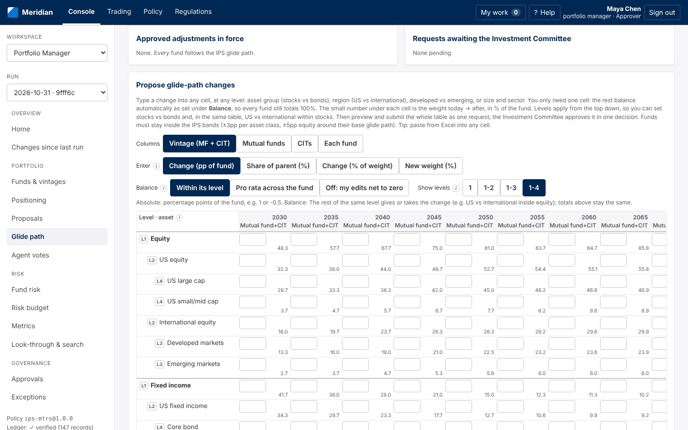
*Image: `pm-13-glide-path.png`*

1. Click **Glide path**. **Glide path today, by fund** lists every vintage with years to retirement, the IPS equity, each product line's equity, and fixed income and real assets.
2. Check **Approved adjustments in force** and **Requests awaiting the Investment Committee** so you don't duplicate one.
3. In **Propose a glide-path adjustment**, set **Apply to**: **All funds**, **All mutual funds**, **All CITs** or one fund.
4. **2. Vintages**: every vintage starts selected (dark). Click a vintage to leave it out, click again to put it back. Shortcuts: **All**, **2030–2045**, **2050–2070**, **Clear**. The line under the buttons says how many vintages and funds are in scope (e.g. "3 vintages selected · 3 funds in scope"). If you chose one fund in step 3, its own vintage applies and the buttons are hidden.
5. Under **Moves**, type the size in pp, choose the asset class it goes **into**, and the one it comes **from** (e.g. Move `0.5` pp into **US Core Bond (Aggregate)** from **US Large Cap Equity**). Click **Add a move** for more.
6. Click **Preview**.

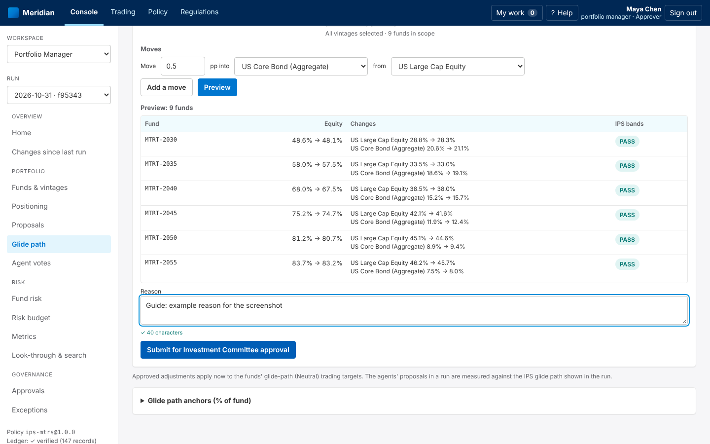
*Image: `pm-14-glide-request.png`*

7. Read **Preview: n funds**: for each fund, the glide path today and after, and whether it stays inside the IPS bands (±3pp per asset class, ±5pp total equity). Changes outside the bands are refused; they need an IPS amendment.
8. Type a reason and click **Submit for Investment Committee approval**.

**You're done when** the green message says it was sent to the Investment Committee and it appears under **Requests awaiting the Investment Committee**. Once approved (7.3) it moves to **Approved adjustments in force** and becomes the funds' glide-path (Neutral) trading target. The agents' proposals in a run are still measured against the IPS glide path shown in the run.

The same request can also be made from Trading → **Glide path & bulk changes** (10.12).

### 3.7 Work the approval queue
**Where:** Console → **Approvals**.

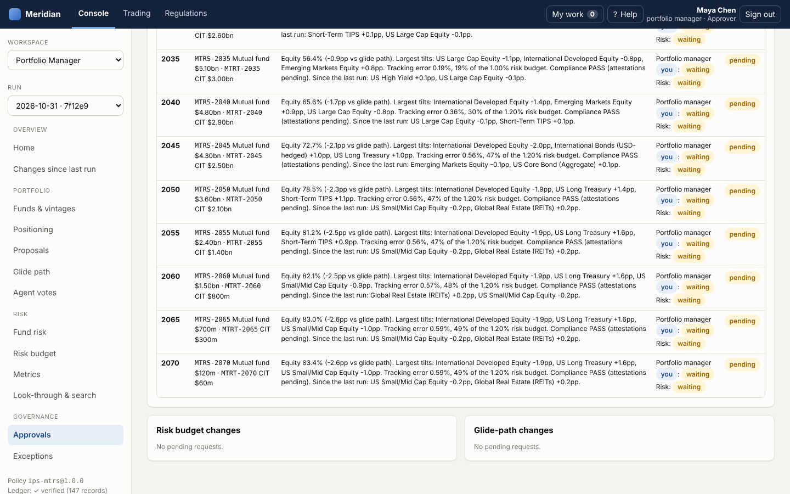
*Image: `pm-12-approvals.png`*

1. Click **Approvals**. **Waiting for you** lists what needs your decision.
2. Further down, each vintage row shows the funds affected with their assets, a one-paragraph summary (equity vs glide path, largest tilts, tracking error against the budget, compliance, what changed since the last run), who has decided (**you**, **Risk**) and the status.
3. Click **Open** on a line to go to that vintage on **Proposals** and decide (3.2).
4. **Risk budget changes** and **Glide-path changes** at the bottom list pending policy requests.

### 3.8 Other PM screens
**Funds & vintages** (every fund by product line; click a fund for its glide path and holdings, see 6) · **Fund risk** and **Look-through & search** (section 4) · **Metrics** (return, volatility, Sharpe, drawdown, TE vs market and glide path; hypothetical) · **Exceptions** (8.2) · **Agent votes** (5.2). Trading: section 10.

**Good practice:** challenge at least one assumption per approval; if a "what would change the view" condition is already close, escalate.

---

## 4. Risk Analytics (persona: Daniel Okafor)

Methods and definitions: doc 13.

### 4.1 Fund-level check
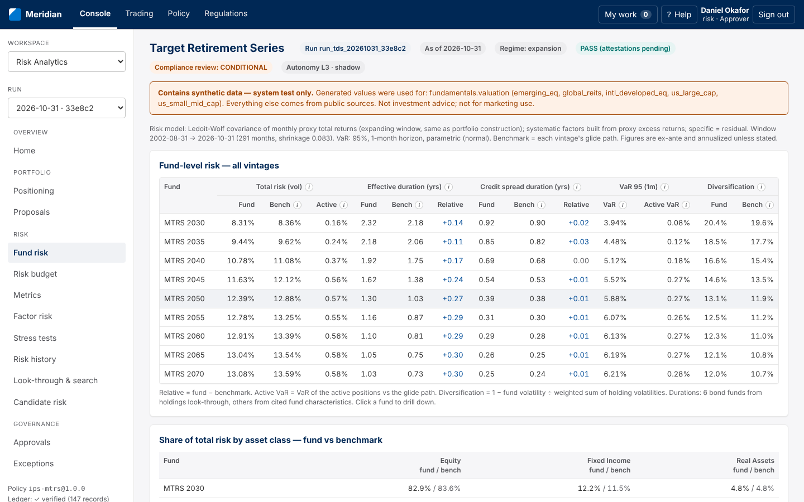
*Image: `risk-01-fund-risk.png`*

1. Click **Fund risk**. Scan every vintage: total vs benchmark risk, active risk, relative duration and spread duration, VaR 95 and active VaR 95, diversification.
2. Click a vintage to drill down: risk by asset class (expand Equity → US/Non-US → size; Fixed Income → long/short-dated → sector) or by underlying fund.
3. Read the **Weight vs. risk** chart: a risk bar much longer than its weight bar is a concentrated risk.

### 4.2 Factor review

*Image: `risk-02-factor.png`*

1. Click **Factor risk**, then **Total**, **Active** or **Benchmark**.
2. In **Factor history**, choose *All except Equity* to see rates, credit, inflation and real-asset risk over 18 months.

### 4.3 Stress tests and the scenario builder

*Image: `risk-03-stress.png`*

1. Click **Stress tests**; choose **Fund**, **Benchmark** or **Active**.
2. Read the historical replays, then the **Normal to extreme** ladder (1σ to 5σ).
3. In **Build a scenario**, type moves (e.g. equities `-20` %, Treasury yields `+100` bp). The loss per vintage updates at once.
4. Switch **Correlated / Isolated** to see how much comes from correlation assumptions. **Reset** clears it.

### 4.4 Find who holds a security (look-through)
**Where:** **Look-through & search**.

*Image: `risk-04-lookthrough.png`*

1. Click **Look-through & search**.
2. Type a ticker or name in the search box (e.g. `NVDA`, `Treasury`). Suggestions appear in a list under the box; the page does not move.
3. Pick one: click it, or use **↓** and **Enter**.

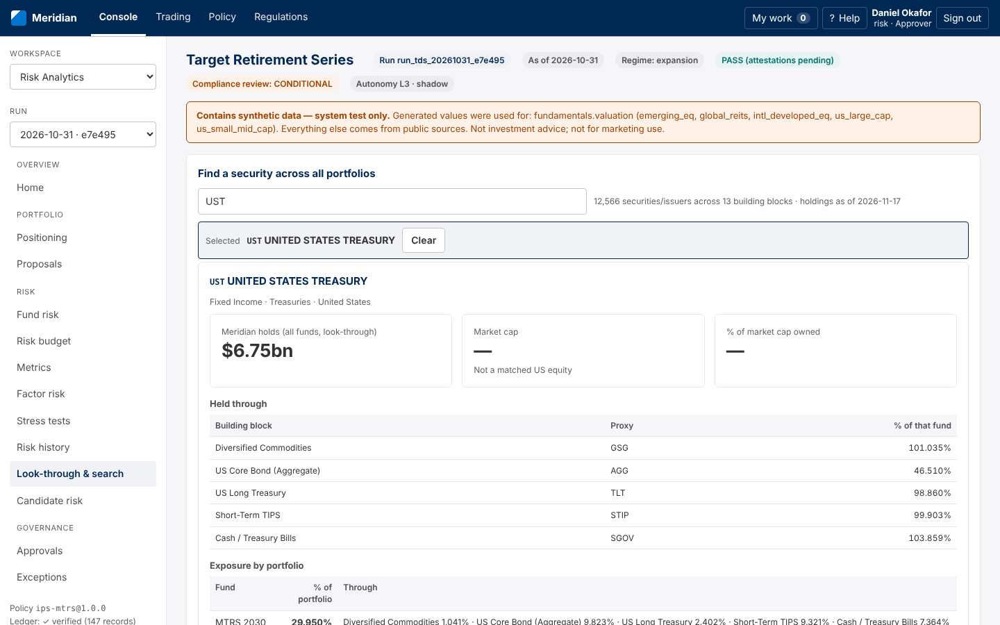
*Image: `risk-06-lookthrough-selected.png`*

4. The bar above the results says **Selected:** and the security. **Exposure by portfolio** shows each vintage's exposure and **Held through** shows which building-block funds hold it.
5. Click **Clear** to search again.

US Treasury securities are grouped under one issuer, **UNITED STATES TREASURY**.

### 4.5 Trend monitoring, limits and co-approval

*Image: `risk-05-history.png`*

1. **Risk history**: pick a metric; each month shows whether it is a recorded snapshot or reconstructed.
2. **Risk budget**: as 3.5; you approve or reject PM budget requests from **Approvals → Risk budget changes**.
3. **Candidate risk**: each construction method's ex-ante volatility, TE vs limit and compliance before the CIO blend.
4. **Approvals** and **Proposals**: co-approve as Risk after the PM (3.2 and 3.7). You can't decide the same vintage twice in two roles.
5. Deeper work: `notebooks/04_risk_analytics_workbench.ipynb` reproduces every figure.

---

## 5. Research / Analyst (persona: Priya Raman)

Analysts have the same preparation abilities as a PM (adjust weights, request glide-path changes, prepare every kind of trade list) but do not approve proposals or trade lists, and cannot rebalance.

### 5.1 Capital market assumptions
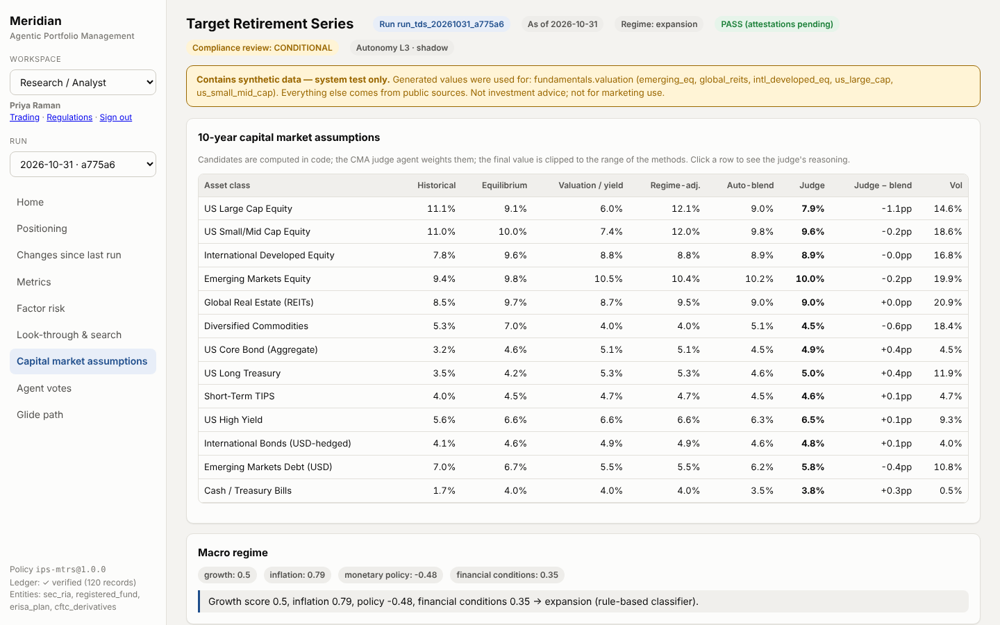
*Image: `res-01-cma.png`*

1. Click **Capital market assumptions**.
2. Click an asset class (e.g. US Large Cap): every method's estimate, the judge's choice vs the auto-blend, the reasoning and method weights. **Why?** shows the records.

### 5.2 Read how the agents voted
**Where:** **Agent votes**.

*Image: `res-02-votes.png`*

1. Click **Agent votes**. **How the agents decided** tells the story of the run in six numbered steps: seven methods each built a portfolio; a neutral risk officer reviewed them (no vote); each agent reviewed two others; agents voted; the top three revised; the CIO agent blended them per vintage.
2. Read the **Scoreboard**: one row per method in plain words (e.g. **Most diversified**, **Balanced risk**), with the risk officer's flag, average peer score, vote points, times voted best and weakest, and the outcome (**shortlisted** or not).
3. Click a method to see its detail.

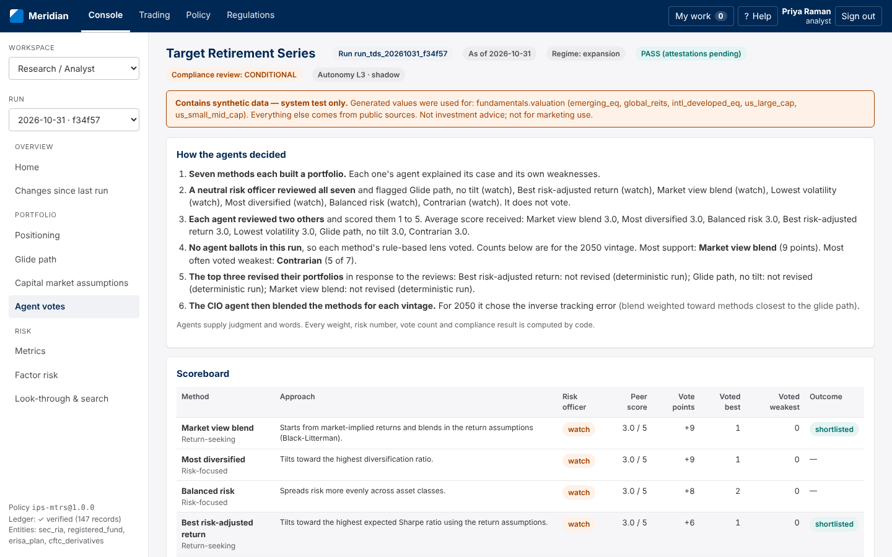
*Image: `res-03-agent-detail.png`*

4. Read **Its case**, **Weaknesses it admits**, **Risk officer**, **Reviews it received**, **How it voted** and **Revision**.

Agents supply judgment and words. Every weight, risk number, vote count and compliance result is computed by code.

### 5.3 Propose a weight adjustment
Follow 3.3 from your **Positioning** tab. An analyst's adjustment needs PM and Risk approval.

### 5.4 Prepare trades
Follow 10.3, 10.5 and 10.6. A PM approves what you prepare. *Rebalance to a target* is for PMs only.

*Not built yet:* forecast-vs-realized history per method; in-app change requests for methods.

---

## 6. Manager Selection (persona: Marcus Webb)

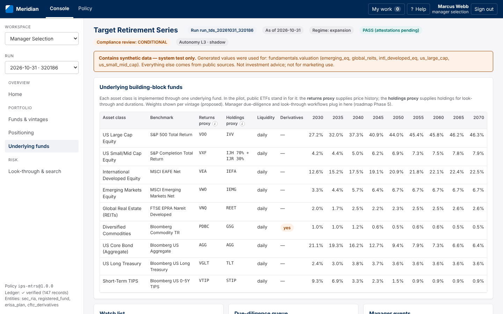
*Image: `mgr-01-funds.png`*

1. **Underlying funds**: each building block with its return proxy and holdings proxy, holdings date and characteristics.
2. **Look-through & search**: who holds an issuer and how much each vintage owns (4.4).
3. **Funds & vintages**: every fund split by product line. Use **All / Mutual funds / CITs** at the top; click a fund to see its glide path and holdings.

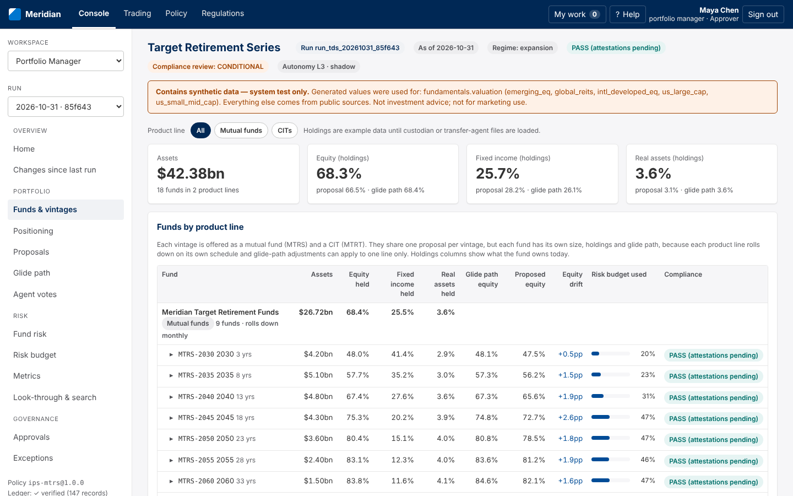
*Image: `pm-08-products.png`*

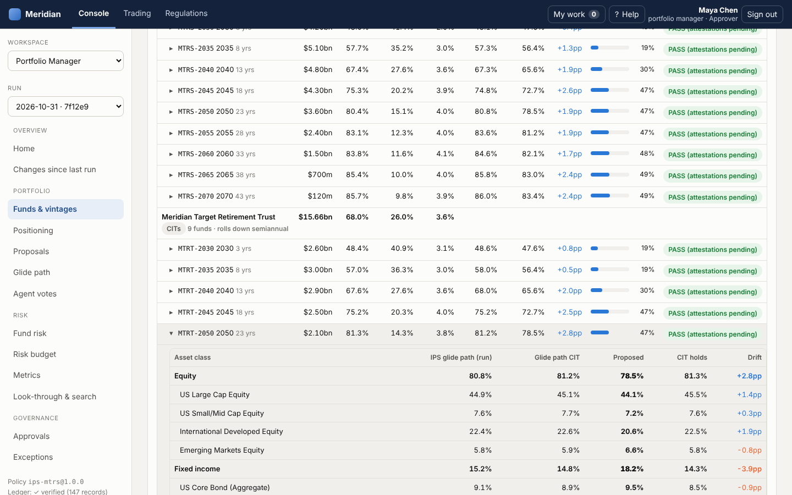
*Image: `pm-09-product-detail.png`*

4. **Positioning**: how the mix differs between vintages (3.3).
5. On Trading, a fund's page lists held securities and **candidates not yet held** (e.g. IEFA, "under manager-selection review").

*Not built yet (Phase 5):* due diligence workflow, scorecards, watch list, fee and overlap views.

---

## 7. Leadership / Investment Committee (persona: Elena Rossi)

### 7.1 Home: what needs you

*Image: `lead-01-home.png`*

1. **Home** shows the series tiles, **Needs your attention** (committee items), **The series at a glance** and **Production blockers** (e.g. the CCO role is filled by a placeholder, Robert Hayes, so it stays a blocker).

### 7.2 Board memo
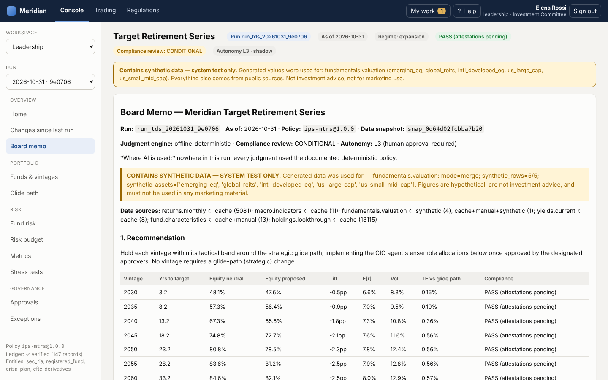
*Image: `lead-02-memo.png`*

1. Click **Board memo**: recommendation, expected performance vs benchmark, macro rationale, changes since last review, key risks, compliance statement and dissenting views.

### 7.3 Decide a glide-path change (Investment Committee)
**Who:** a person with the **Investment Committee member** permission who did not make the request. **Where:** Console → **Glide path** (or Trading → **Glide path & bulk changes**).

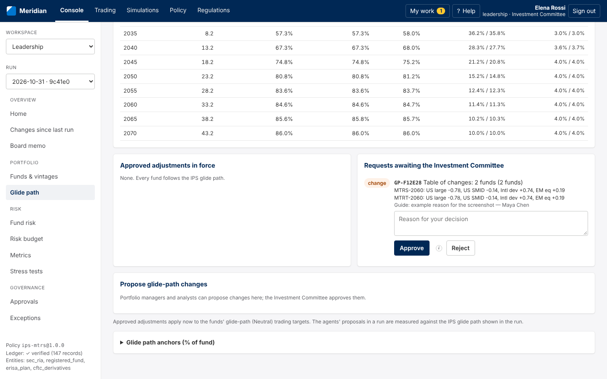
*Image: `lead-03-glide-decide.png`*

1. Click **Glide path**.
2. In **Requests awaiting the Investment Committee**, read the request: its ID, the funds in scope (e.g. "All CITs (9 funds)"), the moves, and the requester's reason and name.
3. Type your reason in the box under the request.
4. Click **Approve** or **Reject**.

**You're done when** the green message says it was approved (or rejected). An approved change appears under **Approved adjustments in force** at once.

**If something goes wrong:** no buttons means you lack the permission or made the request yourself. Ask your admin for the permission, or another committee member to decide.

### 7.4 Other committee work
1. Decide committee items from **Approvals** with the steps in 2.2.
2. **Fund risk** and **Stress tests**: how much each vintage could lose; **Changes since last run**; **Exceptions** (read and comment).

*Not built yet:* kill switch and autonomy controls in the app; KPI view; fee review.

---

## 8. Compliance (persona: Robert Hayes, CCO placeholder; Nina Alvarez, analyst)

### 8.1 Rule results

*Image: `comp-01-compliance.png`*

1. Click **Compliance**: each rule, its IPS section, severity, and the result per vintage from the deterministic engine.
2. Click **Why?** for the records behind a result.

### 8.2 Exceptions: raise, work and close
**Who:** Compliance and Risk raise; Compliance closes; only the CCO accepts. **Where:** Console → **Exceptions**.

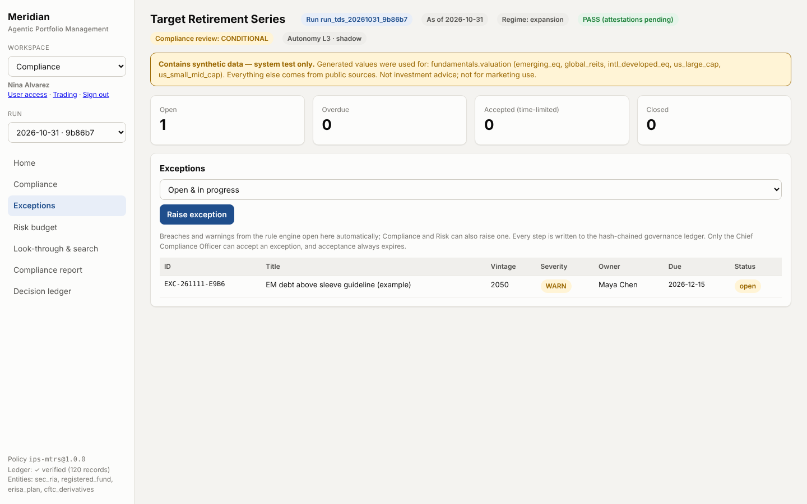
*Image: `comp-02-exceptions.png`*

**Raise one**
1. Click **Exceptions**.
2. Click **Raise exception**. A form titled **Raise an exception** opens.
3. Fill in the title, vintage, severity, owner, due date and details, then click **Raise** (or **Cancel**). The case appears in the list as Open.

**Work one**
4. Click the case in the list.

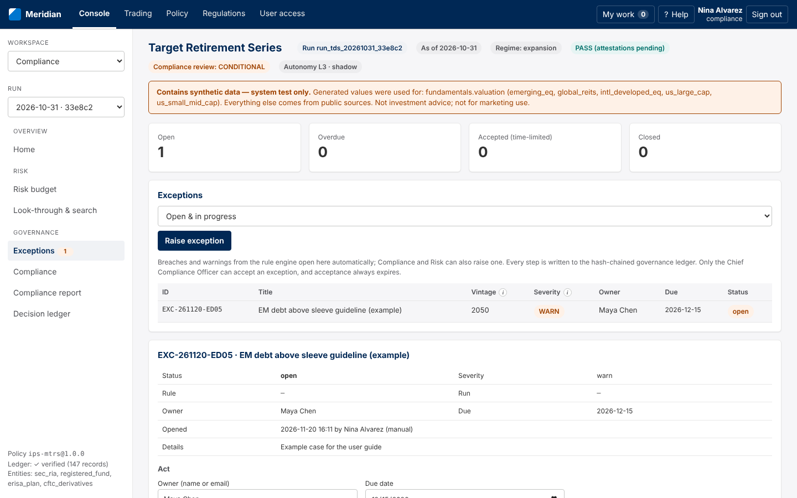
*Image: `comp-03-exception-detail.png`*

5. Under **Act**, choose the action and write a note (kept in the ledger):
   - **Assign / set due date**: set the owner and deadline.
   - **Add note**: record what was done.
   - **Mark remediated**: the fix is in place.
   - **Accept (CCO)**: only the Chief Compliance Officer; set **Accepted until** (at most 365 days). Acceptance always expires.
   - **Close**: Compliance only, and not by the person who opened it alone.
   - **Reopen**: if the issue comes back.
6. Click the action's button.

**You're done when** the case's **History** shows your action. Overdue cases are highlighted; the counters show Open, Overdue, Accepted and Closed.

### 8.3 Ledger search and evidence

*Image: `comp-04-ledger-search.png`*

1. Click **Decision ledger**, then open **Search all runs**.
2. Type words (e.g. `approve 2050`) and, if you want, filter by type, vintage, actor or dates.
3. Click **Search**.
4. **Download CSV** for the matching records; **Download evidence pack (JSON)** for the whole run with its integrity check.

### 8.4 Compliance report and other checks

*Image: `comp-05-report.png`*

1. **Compliance report**: the Agentic Compliance Officer's review, marked **DRAFT** and "not an attestation", with retention applied and production blockers.
2. **Look-through & search**: exposure to a named issuer across all vintages (4.4).
3. **Risk budget**: limits and change requests (3.5).
4. Trading records (cashflow loads, trade lists, previews are *not* recorded, setting and route changes) are in the same ledger with type `trading`; route changes are step `routes.change`.
5. **User access** (read-only): access review and access log.

*Not built yet:* approval-quality audit view, annual-review package, marketing-review routing.

---

## 9. Audit (persona: Grace Liu)

*Image: `aud-01-ledger.png`*

Read-only. No approve buttons anywhere.
1. Check the side-bar footer: **Ledger: ✓ verified (n records)**. Meridian recomputes the hash chain on every page load.
2. **Decision ledger**: filter records; open one to see actor, inputs, output hash and previous hash.
3. **Search all runs** for populations (e.g. every approval in a period); **Download CSV** to sample.
4. **Download evidence pack (JSON)** for a run.
5. **Exceptions**, **Compliance**, **Compliance report**: read-only.
6. **User access** (read-only): access review CSV and the access log.
7. The database itself refuses edits and deletions of ledger records and access-log entries.

*Not built yet:* replay of what an approver saw; WORM copy (deferred to production because it adds cost).

---

## 10. Trading (doc 17)

Open **Trading** in the dark bar (or go to `/trading`). Everything is shadow mode with **example** positions, prices and NAVs until custodian and transfer-agent files are connected.

| Who | Can |
|---|---|
| Portfolio Manager | Everything below, including **Rebalance to a target**, strategic tables, tilts, exits, buffer and exclusions; approving trade lists also needs the **Approver** permission |
| Analyst | Load cashflows; **Invest cashflows**, **Trade a security**, **Exit a position**; tranche and cancel drafts; download the Charles River file after approval |
| Trade route manager (permission) | Change order routes |
| Admin | Buffer and exclusions |
| Risk, Compliance, Audit, Leadership | Read-only |

### 10.1 How Trading is laid out
The tabs, in order:

| Tab | Use it to |
|---|---|
| **New trade** (opens first) | Set up any trade, see its impact, save it as a draft |
| **Trade lists** | Open saved drafts: impact, orders, tranches, approve, export, fills |
| **Funds & securities** | See each fund's holdings and targets, edit a strategic table, load positions |
| **Cashflows** | Load subscriptions and redemptions |
| **Glide path & bulk changes** | Change many funds at once (10.12) |
| **Routing & settings** | Routes, cash buffer, tilts, exits, exclusions (10.11) |

The **All funds / Mutual funds / CITs** switch at the top right filters every tab. Mutual funds are `MTRS-2030`…`2070`, CITs `MTRT-2030`…`2070`.

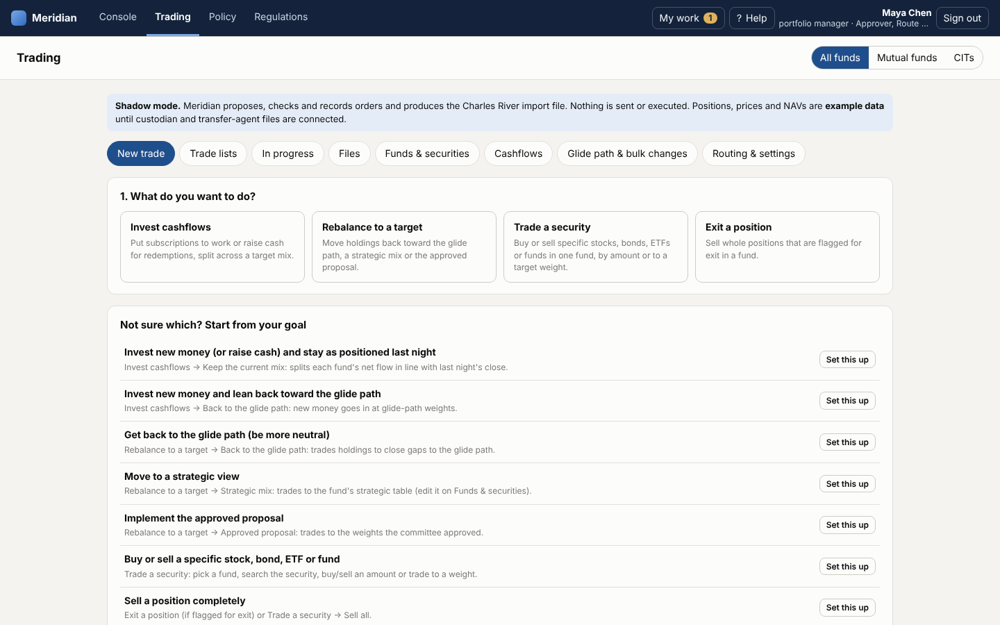
*Image: `trd-21-new-trade.png`*

Every trade follows the same four steps on **New trade**:
1. **What do you want to do?** Click one of four tiles: **Invest cashflows**, **Rebalance to a target**, **Trade a security**, **Exit a position**.
2. **Set it up**: choose the mix, funds or securities.
3. **Impact: now vs after these trades**: click **See the impact**. Nothing is saved yet.
4. **Create the draft trade list**: type a reason and click **Create draft trade list**.

**Not sure which tile?** Under the tiles, **Not sure which? Start from your goal** lists common goals. Click **Set this up** on a row and Meridian picks the right tile and mix for you:

| Goal | Sets up |
|---|---|
| Invest new money (or raise cash) and stay as positioned last night | Invest cashflows → **Keep the current mix** |
| Invest new money and lean back toward the glide path | Invest cashflows → **Back to the glide path** |
| Get back to the glide path (be more neutral) | Rebalance to a target → **Back to the glide path** |
| Move to a strategic view | Rebalance to a target → **Strategic mix** |
| Implement the approved proposal | Rebalance to a target → **Approved proposal** |
| Buy or sell a specific stock, bond, ETF or fund | Trade a security |
| Sell a position completely | Exit a position |

**The four mixes**
| Mix | What it means |
|---|---|
| **Keep the current mix** | Each fund's weights at last night's close. Only for investing cashflows |
| **Back to the glide path** | Each fund's glide-path (neutral) weights, including approved glide-path adjustments |
| **Strategic mix** | Each fund's strategic table: a custom mix set by a PM, or the glide path where none is set (10.2) |
| **Approved proposal** | The asset-class weights PM and Risk approved in the console for the fund's vintage |

### 10.2 Look at a fund (and edit its strategic table)
**Where:** Trading → **Funds & securities**.

*Image: `trd-01-funds.png`*

1. Click **Funds & securities**. The table shows NAV, cash, glide-path roll-down (monthly, quarterly, semiannual or annual), cash buffer, positions source and whether the strategic table follows the glide path.
2. Click a fund.

*Image: `trd-02-fund-detail.png`*

3. **Held securities** and **Not held: candidates and available securities**. Chips: *Held · no target* (never part of cash allocation), *Not held · candidate*, *Excluded from trading*, *Exiting*, *Tilt ±bp*.
4. Target columns: **Previous close**, **Neutral**, **Strategic**, **Approved proposal** (before tilts and exits).
5. To trade this fund, use the buttons under the tables:

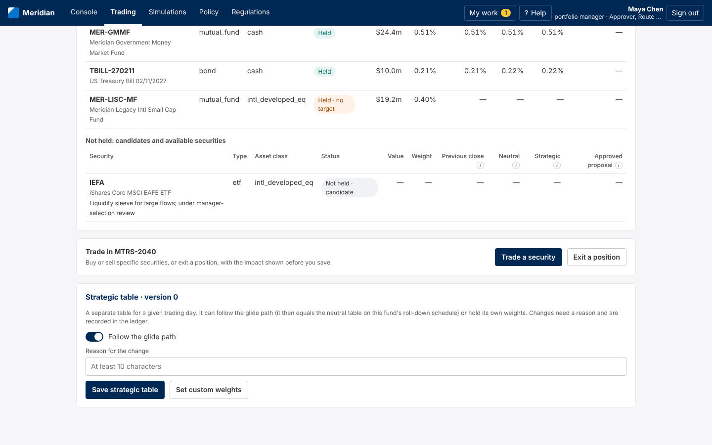
*Image: `trd-03-fund-trade-buttons.png`*

   - **Trade a security** opens New trade → Trade a security with this fund chosen (10.5).
   - **Exit a position** opens New trade → Exit a position with this fund chosen (10.6).
6. **Strategic table** (PMs): leave **Follow the glide path** on, or click **Set custom weights**, type weights totalling 100%, give a reason and click **Save strategic table**. Each save is a new version in the ledger.

### 10.3 Invest cashflows (night close, glide path, strategic or approved)
**Who:** PM or analyst. **Where:** Trading → **Cashflows**, then **New trade**.
**Before you start:** decide which product line (switch at the top right).

**Step A: load the cashflows**

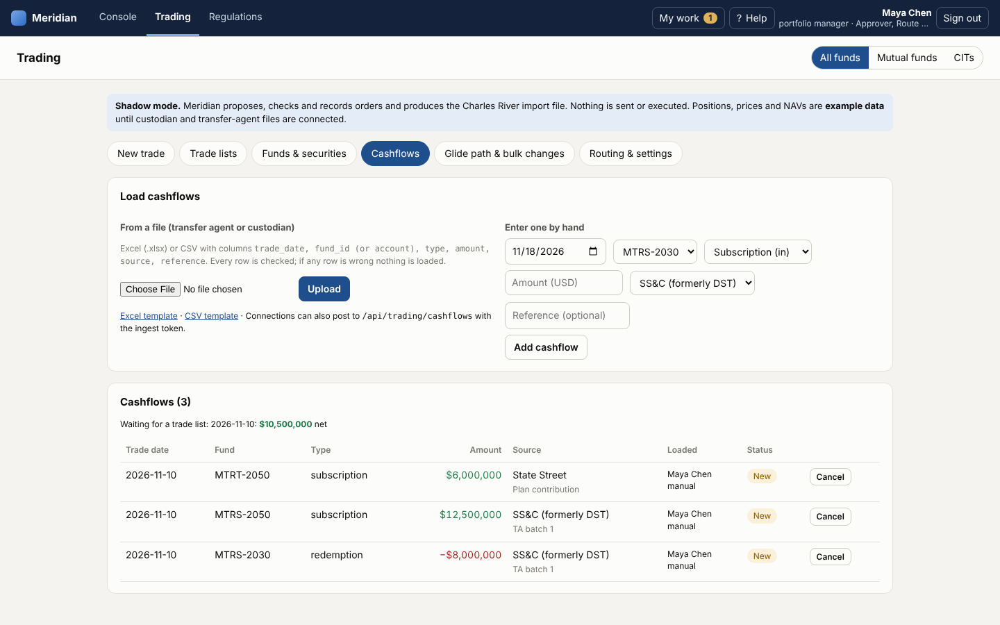
*Image: `trd-04-cashflows.png`*

1. Click **Cashflows**.
2. Load them one of three ways:
   - **From a file:** click **Excel template** (or CSV), fill in `trade_date, fund_id (or account), type, amount, source, reference`, choose the file and click **Upload**. If any row is wrong, nothing is loaded and the message names the row.
   - **By hand:** choose the date, fund, **Subscription** or **Redemption**, amount and source; click **Add cashflow**.
   - **By connection:** transfer agents and custodians post to `/api/trading/cashflows` with the ingest token.
3. Check the list: new cashflows show **New**. To remove one, click **Cancel**, give a reason and click **Cancel cashflow**.

**Step B: set up the trade**

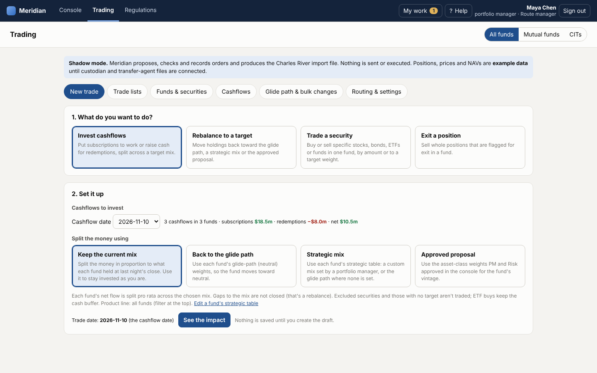
*Image: `trd-22-invest-setup.png`*

4. Click **New trade**, then the **Invest cashflows** tile (or a goal under **Start from your goal**).
5. **Cashflow date**: pick the date. The line beside it shows how many cashflows, in how many funds, subscriptions, redemptions and net.
6. **Split the money using**: click a mix: **Keep the current mix** (last night's close), **Back to the glide path**, **Strategic mix** or **Approved proposal**. The trade date is the cashflow date.
7. Click **See the impact**.

**Step C: check the impact (10.7), then save**
8. Read the impact panel. In particular: buys and sells, uninvested cash before → after, **Off target (avg)** before → after, and compliance after. Click a fund in **By fund** to see its asset mix.
9. Scroll to **4. Create the draft trade list**, type a reason (e.g. "Invest 10 Nov flows at last close"), click **Create draft trade list**.

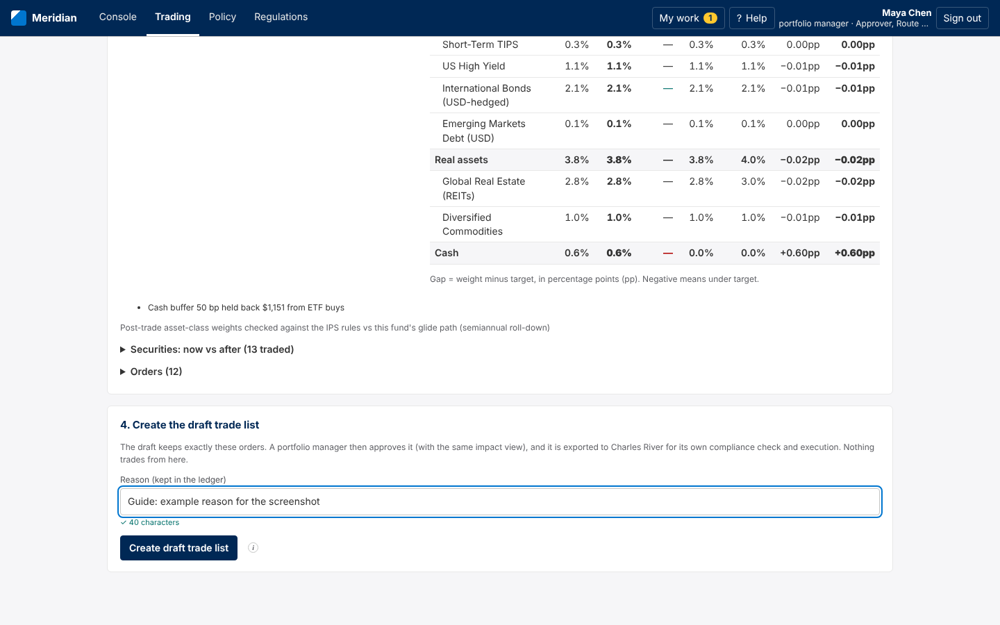
*Image: `trd-25-create-draft.png`*

**You're done when** Meridian switches to **Trade lists** with your new draft open and a green message "…draft created with n orders". A PM then approves it (10.9).

**What Meridian does:** each fund's net flow is split pro rata across the chosen mix (gaps to the mix are not closed; that is a rebalance). Tilts and exits apply; securities with no target or excluded are skipped; ETF buys keep the cash buffer; it never sells more than is held. Orders go to: CITs → State Street, mutual funds → SS&C (formerly DST), ETFs, stocks and bonds → internal trading desk.

### 10.4 Rebalance to a target (back to the glide path, strategic, approved proposal)
**Who:** PM only. **Where:** Trading → **New trade**.

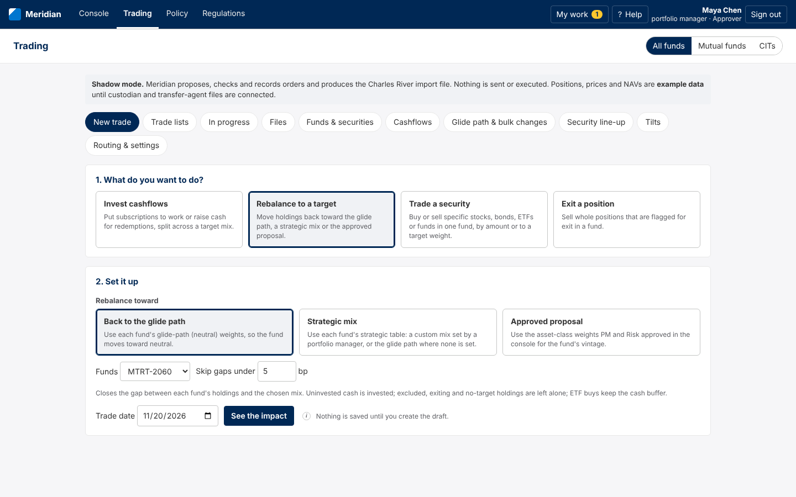
*Image: `trd-14-rebalance.png`*

1. Click the **Rebalance to a target** tile (or **Get back to the glide path**, **Move to a strategic view** or **Implement the approved proposal** under **Start from your goal**).
2. **Rebalance toward**: click **Back to the glide path**, **Strategic mix** or **Approved proposal**.
3. **Funds**: leave **All funds** (everything in the switch at the top right) or choose one fund.
4. **Skip gaps under**: the smallest gap worth trading, in bp of NAV (default 5).
5. Choose the **Trade date**.
6. Click **See the impact**. Check that **Off target** falls for each fund (10.7).
7. Type a reason and click **Create draft trade list** (`RB-…`).

**You're done when** the draft opens on **Trade lists**. Approve it like any list (10.9).

Uninvested cash is invested; holdings with no target, excluded and exiting securities are left alone; ETF buys keep the cash buffer. If a regulation control on a fund fails, the impact shows it and the draft can be saved but not approved:

*Image: `trd-15-rebalance-blocked.png`*

### 10.5 Trade a specific security (buy, sell, or trade to a weight)
**Who:** PM or analyst. **Where:** Trading → **New trade** → **Trade a security** (or a fund's page → **Trade a security**).

1. Click the **Trade a security** tile.
2. **Fund**: choose the fund (e.g. `MTRS-2040 · Mutual fund 2040`).
3. Under **Find a security**, type a ticker, name or asset class (e.g. `VTI`, `Treasury`, `emerging`). Without typing you see the 12 largest holdings. Each row shows the asset class, what is held, its weight and its glide-path target.

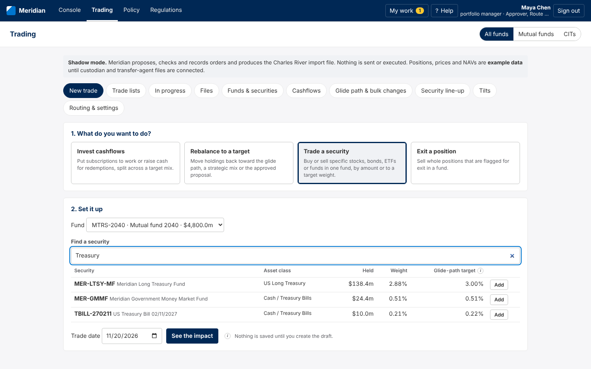
*Image: `trd-26-security-search.png`*

4. Click **Add** on the security. It moves to **Orders in this ticket**. Add more securities the same way.
5. For each order choose the **Action**:
   - **Buy amount**: type dollars.
   - **Sell amount**: type dollars.
   - **Trade to weight**: type the weight you want as % of NAV (it starts at today's weight). Meridian works out whether that is a buy or a sell.
   - **Sell all**: sells the whole position.
6. Read **Estimated trade** and **Weight after** on each row, and the cash line under the table.

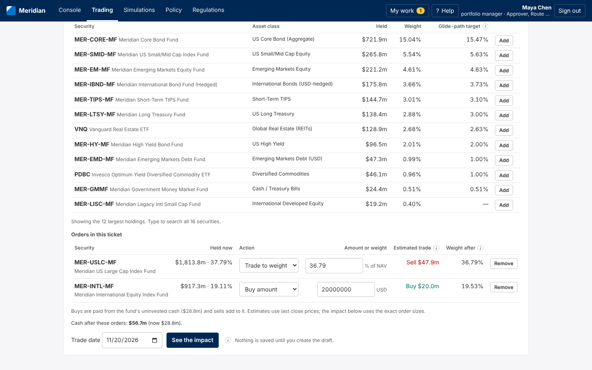
*Image: `trd-27-security-ticket.png`*

7. If you see **Not enough cash**, the buys cost more than the fund's uninvested cash. Add a sell (e.g. trade an overweight holding down to its target) or lower the buy.
8. Choose the **Trade date** and click **See the impact**.

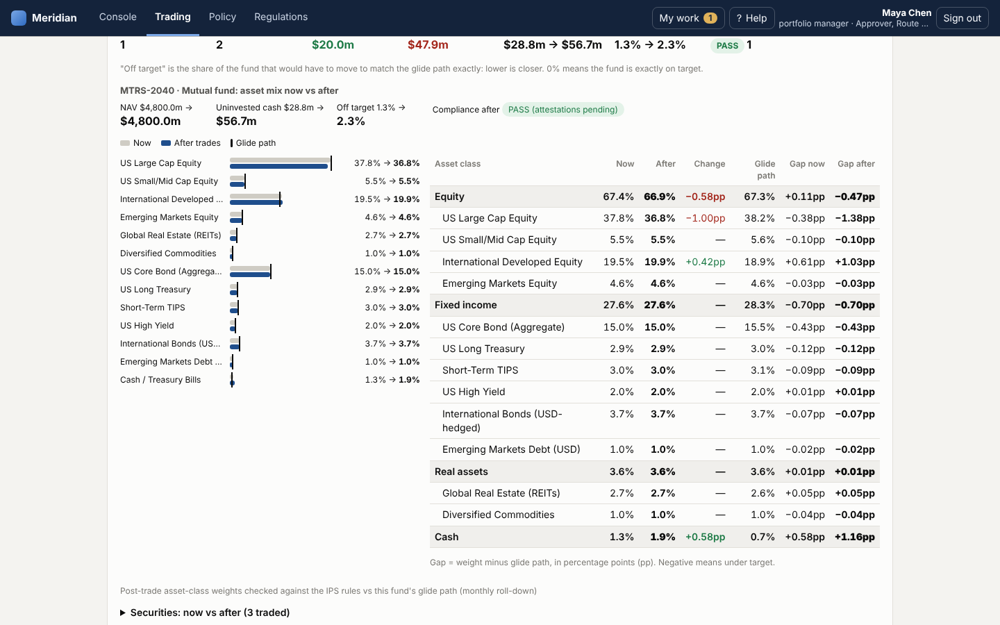
*Image: `trd-28-security-impact.png`*

9. Check the asset mix now vs after against the glide path (10.7), type a reason and click **Create draft trade list** (`TK-…`).

**You're done when** the draft opens on **Trade lists**. It is approved, tranched and exported like any list.

To remove an order before saving, click **Remove** on its row.

### 10.6 Exit a position completely
**Who:** PM or analyst (flagging a security for exit is PM only). **Where:** Trading → **New trade** → **Exit a position**.
**Before you start:** the security is flagged for exit in that fund (10.11, **Full exits**). If it isn't, use 10.5 with **Sell all** instead.

1. Click the **Exit a position** tile (or **Exit a position** on the fund's page).
2. **Fund**: choose the fund. **Flagged for exit and still held** lists what will be sold.
3. Choose the **Trade date** and click **See the impact**.
4. Type a reason and click **Create draft trade list** (`EX-…`).

**You're done when** the draft opens on **Trade lists**. Each whole flagged position is sold; proceeds stay in cash (reinvesting them is a rebalance). To sell down gradually, tranche it (10.8).

### 10.7 Read the impact: now vs after
The same panel appears in step 3 of **New trade** and on every saved list (**Trade lists** → **Impact: now vs after**).

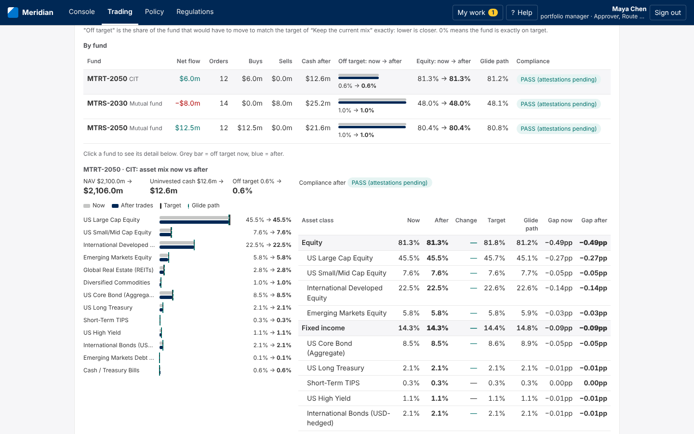
*Image: `trd-23-impact.png`*

1. **Top line**: funds, orders, buys, sells, **Uninvested cash** now → after, **Off target (avg)** now → after, and **Compliance after** (count of PASS / WARN / FAIL).
   - *Off target* is the share of the fund that would have to move to match the chosen mix exactly. Lower is closer; 0% is exactly on target.
2. **By fund** (when there is more than one fund): net flow, orders, buys, sells, cash after, an **Off target** bar (grey = now, blue = after), equity now → after, the glide-path equity, and compliance. Click a fund row to show its detail below.

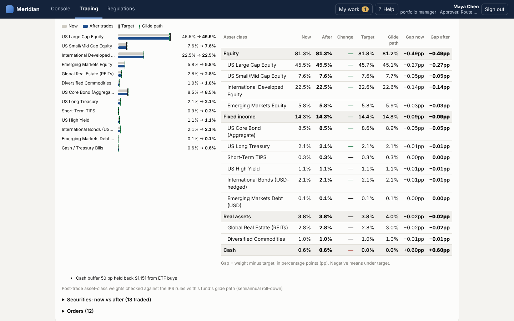
*Image: `trd-24-impact-fund.png`*

3. **Asset mix now vs after** for the chosen fund:
   - Left, a bar per asset class: grey = now, blue = after trades, black tick = target, green tick = glide path.
   - Right, a table grouped into Equity, Fixed income, Real assets and Cash: **Now**, **After**, **Change**, **Target**, **Glide path**, **Gap now** and **Gap after** (weight minus target, in pp; negative = under target).
4. Notes (e.g. cash buffer held back), errors, and compliance details. Post-trade asset-class weights are checked against the IPS rules and that fund's own glide path, plus the controls of any regulation tagged on the fund (section 12). An error or FAIL blocks approval.
5. **Securities: now vs after** (click to open): every security's value and weight now, the trade, value and weight after, target and gap after.
6. **Orders** (click to open): side, security, type, quantity (units, whole shares or $1,000 face), estimated price and amount, destination.

**What a good result looks like:** for a rebalance, *Off target* falls and gaps shrink toward 0; for cash investment, cash after is close to the buffer and gaps don't widen; compliance stays PASS.

### 10.8 Tranche a trade list (optional)
**Who:** PM or analyst. **Where:** Trading → **Trade lists** → a **Draft** list → **Tranches**.

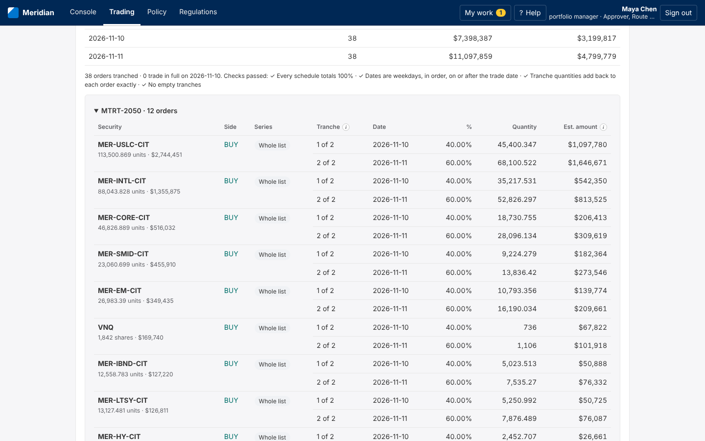
*Image: `trd-07-tranches.png`*

1. Open the draft and click **Tranches**.
2. Build the series: dates and percentages. Click **Add a date**, **Split equally**, or type unequal percentages; the total must be 100%.

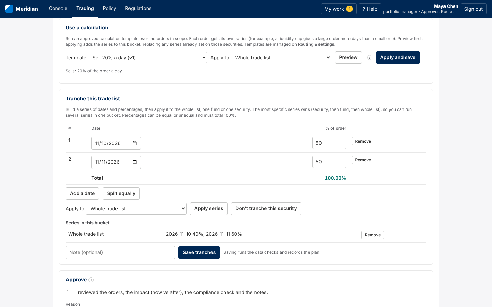
*Image: `trd-08-tranche-editor.png`*

3. In **Apply to**, choose **Whole trade list**, a fund or a single security; click **Apply series**. Repeat for other funds or securities: the most specific series wins. **Don't tranche this security** leaves one order whole.
4. Click **Save tranches**.

**You're done when** **Bucket by date** shows totals per date and each order shows "1 of n". Meridian checks every series totals 100%, dates are weekdays and not market holidays, in order and not before the trade date, quantities respect lot sizes and add back exactly, and no tranche is empty. Tranches can be changed until the list is approved.

### 10.9 Approve a trade list and export it to Charles River
**Who:** a PM with the **Approver** permission approves; PM or analyst downloads. **Where:** Trading → **Trade lists**.

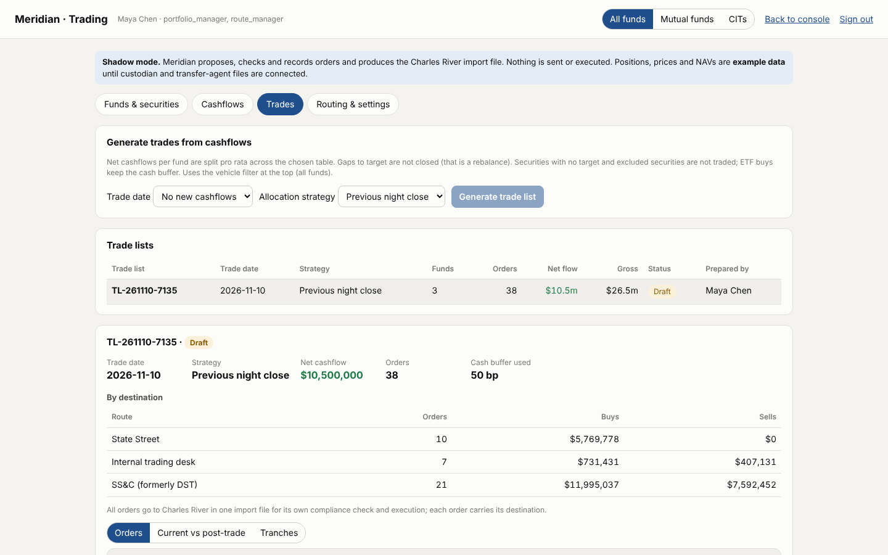
*Image: `trd-05-trade-list.png`*

1. Click **Trade lists** and click the list (or open it from **My work**). It opens on **Impact: now vs after**.
2. Read the impact (10.7) and the **Orders** view (by destination, then each order).

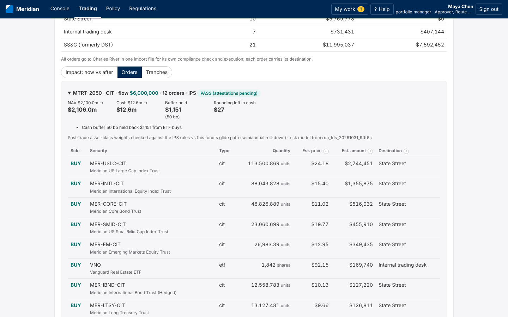
*Image: `trd-06-orders.png`*

3. Scroll to **Approve**. If you see a note about the **Approver** permission instead of a checkbox, your account doesn't have it; ask an admin (11.2). Tick **I reviewed the orders, the impact (now vs after), the compliance check and the notes**.

*Image: `trd-09-approve.png`*

4. Type a reason and click **Approve trade list**. If you also prepared the list, the approval is flagged.
5. Click **Download Charles River import file**.

*Image: `trd-10-charles-river.png`*

**You're done when** the list shows **Exported**. The file has one row per order, or per tranche with its date, parent order ID and "n of N". The layout is a **mock** until mapped to your Charles River import specification. Each download is recorded with a SHA-256 fingerprint.

**Cancel instead:** before export, click **Cancel trade list and release cashflows**, give a reason in the box and click **Cancel trade list**. Its cashflows go back to **New**.

**If the Approve button is greyed out:** the list shows "Blocked by errors or a compliance FAIL". Open the impact, read the red box for the fund, fix the cause (e.g. a smaller trade, a different mix) with a new draft, and cancel this one.

### 10.10 Record fills and book positions
**Where:** Trading → **Trade lists** → an exported list.

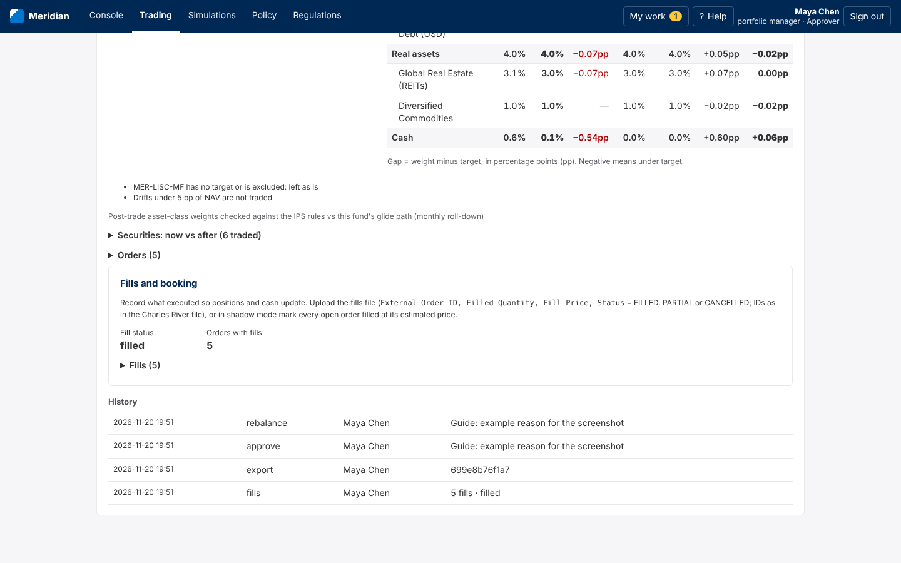
*Image: `trd-16-fills.png`*

1. Open the exported list and scroll to **Fills and booking**.
2. Upload the fills file (`External Order ID, Filled Quantity, Fill Price, Status` = FILLED, PARTIAL or CANCELLED; IDs as in the Charles River file, one per order or tranche). In shadow mode you can instead click **Mark all open orders filled at estimated prices**.

**You're done when** the list shows **Filled and booked** and the fund's **Positions** column on Funds & securities shows "Booked from …". Each fill updates the fund's positions and cash; the list's cashflows settle into cash at the first booking.

### 10.11 Routing & settings
**Where:** Trading → **Routing & settings**.

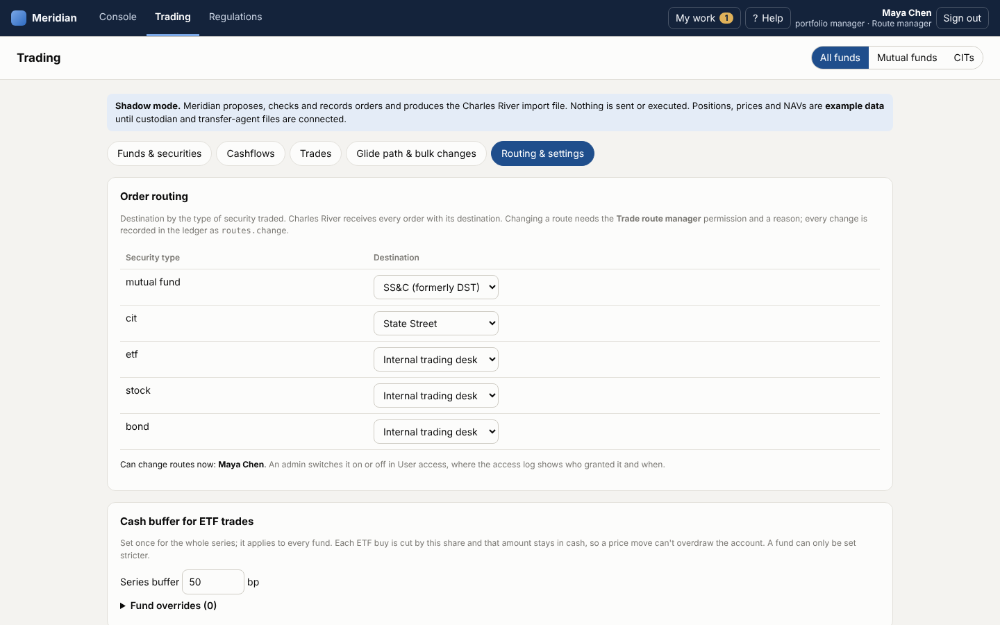
*Image: `trd-11-settings.png`*

1. **Order routing** (Trade route manager permission only): choose the destination for each security type. The tab names who holds the permission.
2. **Cash buffer for ETF trades** (PM, admin): series buffer in bp (default 50), stricter fund overrides.

*Image: `trd-12-tilts-exits.png`*

3. **Tilts** (PM): choose security, fund (or all funds, all mutual funds, all CITs), ±bp, optional end date; click **Add tilt**. Funded pro rata from the other holdings.
4. **Full exits** (PM): choose security and fund; click **Flag for exit**.
5. **Excluded from trading** (PM, admin): security, fund, optional end date; choose whether an excluded share is spread over the other holdings or stays in cash.
6. Type a **Reason for these changes** and click **Save settings**. Everything on the tab is saved together.

**You're done when** the green message says "Saved and recorded: …". **Trading change log** at the bottom lists every trading record from the ledger.

### 10.12 Change many funds at once: glide path, strategic table, tilts, exclusions, exits, roll-down, buffer
**Where:** Trading → **Glide path & bulk changes**.

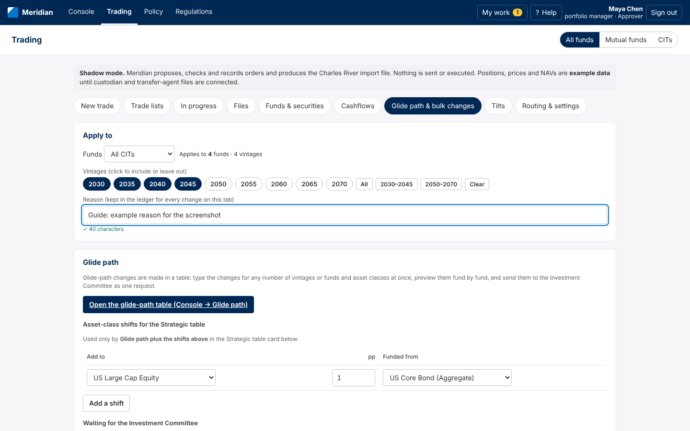
*Image: `trd-17-glide-path.png`*

1. **Apply to:** choose **All funds**, **All mutual funds**, **All CITs** or one fund in **Funds**. Then, under **Vintages**, click the vintages to include or leave out (all start selected; shortcuts **All**, **2030–2045**, **2050–2070**, **Clear**). Beside **Funds** it says how many funds and vintages that is, e.g. "Applies to 4 funds · 4 vintages". With nothing selected it says **Pick at least one vintage** and refuses every change on the tab.
2. Type one reason; it is recorded with every change made on this tab.
3. **Glide path** (needs Investment Committee approval; same as 3.6):
   - Add one or more shifts: asset class, ± pp, funded from another asset class.
   - Click **Preview**. For each fund: the IPS glide path, the current one and the new one, and whether it stays inside the IPS bands.

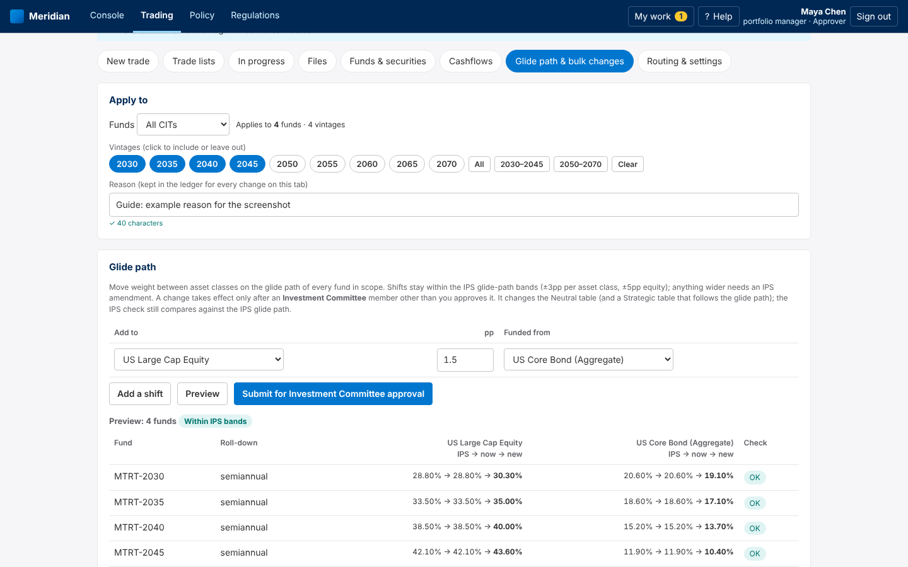
*Image: `trd-18-glide-preview.png`*

   - Click **Submit for Investment Committee approval**. Nothing changes until a committee member other than you approves it:

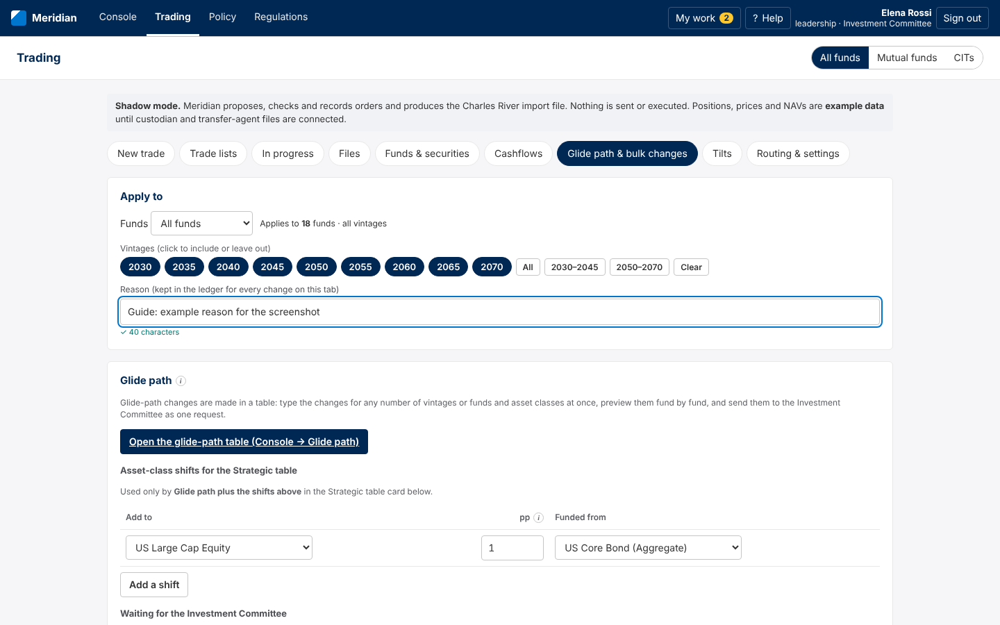
*Image: `trd-19-glide-approve.png`*

   - Once approved, it shows under **In force** and on the funds list as *Glide path adjusted*; it changes the glide-path (Neutral) target and any strategic table that follows the glide path. **Request retirement** undoes it, again with committee approval.
4. **Strategic table** (PM): **Follow the glide path**, or **Glide path plus the shifts above**, for every fund in scope at once (no committee approval; each fund gets a new version).

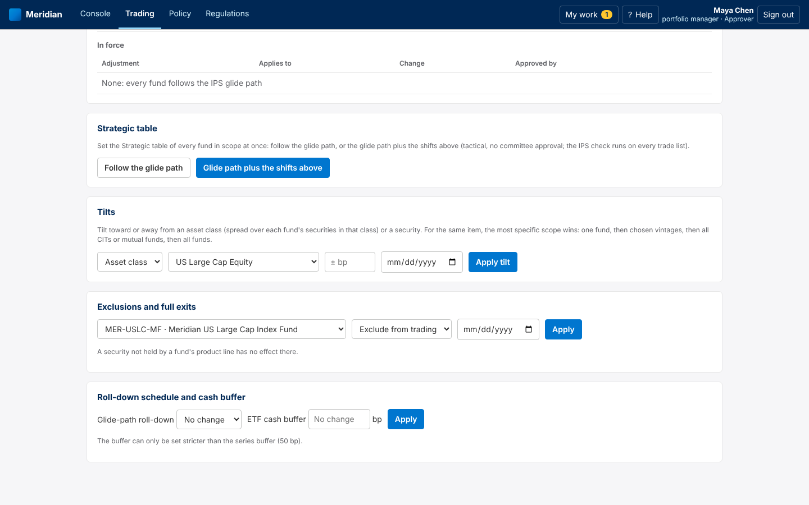
*Image: `trd-20-bulk-tilts.png`*

5. **Tilts** (PM): an asset class (spread over each fund's securities in that class) or a security, ± bp, optional end date; click **Apply tilt**. For the same item the most specific scope wins: one fund, then chosen vintages, then all CITs or all mutual funds, then all funds.
6. **Exclusions and full exits**: a security, exclude or flag for exit, optional end date; click **Apply**.
7. **Roll-down schedule and cash buffer**: set the roll-down frequency and/or a stricter ETF buffer for every fund in scope; click **Apply**.

### 10.13 Load positions (holdings at last close)
**Who:** PM. **Where:** Trading → **Funds & securities**, bottom of the page.

*Image: `trd-13-positions-upload.png`*

1. Click **CSV template** to download it.
2. Fill one row per holding: `as_of, fund_id (or account), security_id (or CUSIP), quantity and price, or market_value`. Use `CASH` as the security for uninvested cash.
3. Choose the file and click **Upload positions**.

**You're done when** the **Positions** column shows the file and its date. Every fund in the file gets these holdings in place of the example data; any bad row (unknown fund or security, missing value) stops the whole load.

### 10.14 Worked examples, start to finish
**A. Invest today's subscriptions as positioned last night (CITs only)**
1. Top right: click **CITs**.
2. **Cashflows** → add or upload today's flows (10.3 step A).
3. **New trade** → **Start from your goal** → **Invest new money (or raise cash) and stay as positioned last night** → **Set this up**.
4. Check the cashflow date → **See the impact** → check cash after and compliance → reason → **Create draft trade list**.
5. A PM with the Approver permission: **Trade lists** → tick the box → reason → **Approve trade list** → **Download Charles River import file**.

**B. Bring the 2050 mutual fund back to the glide path**
1. Top right: click **Mutual funds**.
2. **New trade** → **Get back to the glide path (be more neutral)** → **Set this up**.
3. **Funds** → `MTRS-2050`. **See the impact**. Check *Off target* falls and the gaps shrink.
4. Reason → **Create draft trade list** → approve and export as in A.5.

**C. Cut US large cap in MTRS-2040 by 1 point and buy international with the proceeds**
1. **New trade** → **Trade a security** → **Fund** `MTRS-2040`.
2. Search `large cap` → **Add** on the US large cap fund → **Trade to weight** → type today's weight minus 1.
3. Search `international` → **Add** → **Buy amount** → type the amount shown as the sell's **Estimated trade**.
4. Check **Cash after these orders** is not negative → **See the impact** → check the equity mix against the glide path → reason → **Create draft trade list**.

---

## 11. Platform Admin: User access (persona: Sam Patel)

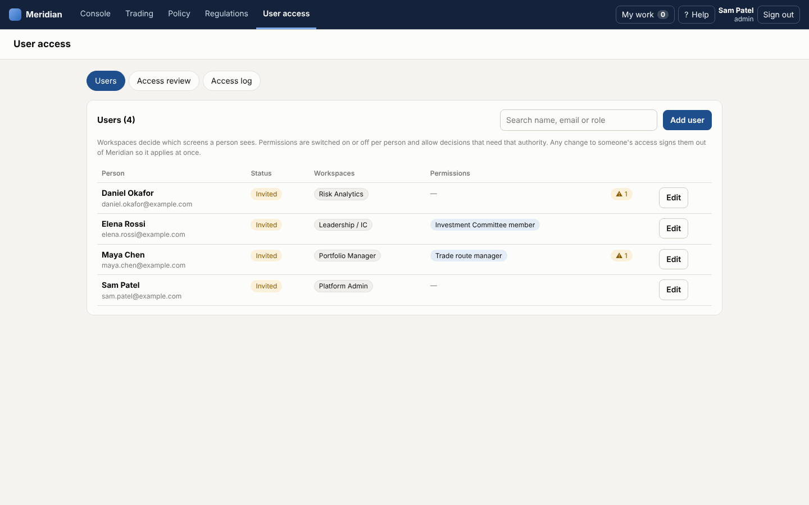
*Image: `adm-01-users.png`*

### 11.1 Add a user
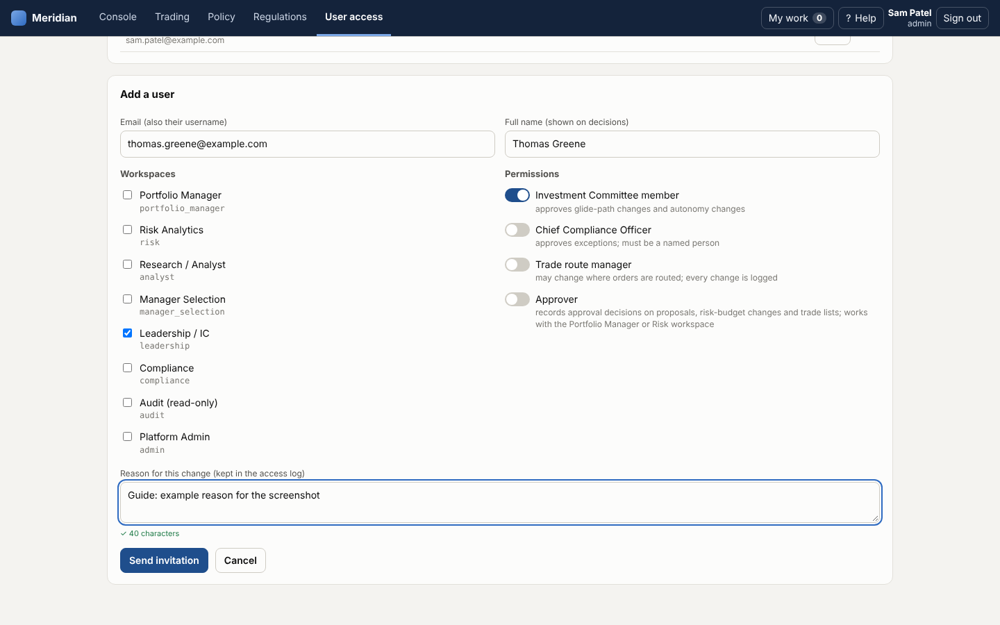
*Image: `adm-02-add-user.png`*

1. Click **Add user**.
2. Type the email (also the username) and full name (shown on every decision).
3. Tick **Workspaces**; switch **Permissions** on as needed (Investment Committee member, Chief Compliance Officer, Trade route manager, **Approver**). A Portfolio Manager or Risk user needs **Approver** to record approvals; without it they review only.
4. Read any **Check before saving** warnings (e.g. a permission without its workspace, a proposer who can also approve, more than one CCO).
5. Type a reason (at least 10 characters) and click **Send invitation**.

**You're done when** the person appears in the list as invited. Cognito emails them a temporary password (1.1).

### 11.2 Edit, disable, delete
1. **Edit**: click **Edit** on a person; change workspaces, permissions or name; type a reason; click **Save**. The person is signed out at once and the new access applies.
   - **To give someone approval authority:** Edit → switch **Approver** on (they also need the Portfolio Manager or Risk workspace) → reason (e.g. "Approver per IC minute 12") → **Save**. To take it away, switch it off the same way. Both show in the **Access log** (11.3) with who changed it, when, before and after, and the reason, and in the **Access review** CSV.
2. **Disable** blocks sign-in (history is kept); **Enable** reverses it; **Resend invitation** re-sends the email.
3. **Delete account…** works only on a disabled account. Type the person's email in the box; **Delete account** stays greyed out until it matches.
4. You can't remove your own admin role, disable or delete yourself, or remove the last enabled admin.

### 11.3 Access review and access log

*Image: `adm-03-review.png`*

1. **Access review**: who holds which workspace and permission; **Download CSV** for periodic reviews.

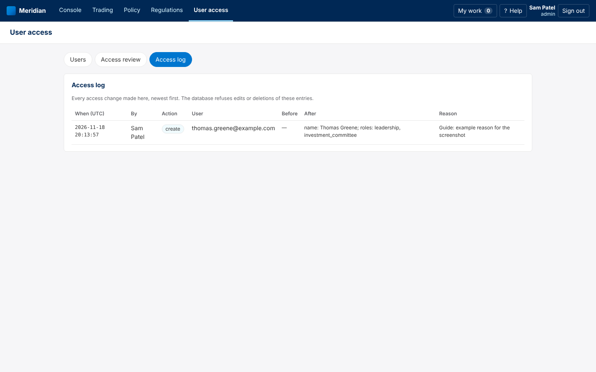
*Image: `adm-04-log.png`*

2. **Access log**: every change with when, who, action, before, after and reason. The database refuses edits or deletions.

Deploys, agent runs and the fallback `manage-users` workflow are in GitHub Actions (doc 14).

---

## 12. Regulations & obligations (doc 18)

Open **Regulations** in the dark bar (`/regulations`). The same All / Mutual funds / CITs switch applies.

### 12.1 Tag funds with a regulation (Compliance)

*Image: `reg-01-tag.png`*

1. On **Funds**, tick the funds (or the box in the header for every fund in the filter). Suggested tags show under each fund.
2. Choose the regulation: **United States (domestic)** or **International (ex-US)**, e.g. ACT 40, ERISA, CIT (OCC 9.18), UCITS, UK COLL, NI 81-102.
3. For ACT 40, tick **Relies on Rule 12d1-4** if fund-of-funds agreements are in place (the 12(d)(1)(A) limits then don't apply).
4. Type a reason (e.g. the prospectus or board resolution) and click **Add to ticked funds**.

**You're done when** the funds show the tag and their obligations are created.

**Remove from ticked funds** is only for the Chief Compliance Officer; it cancels that regulation's open obligations.

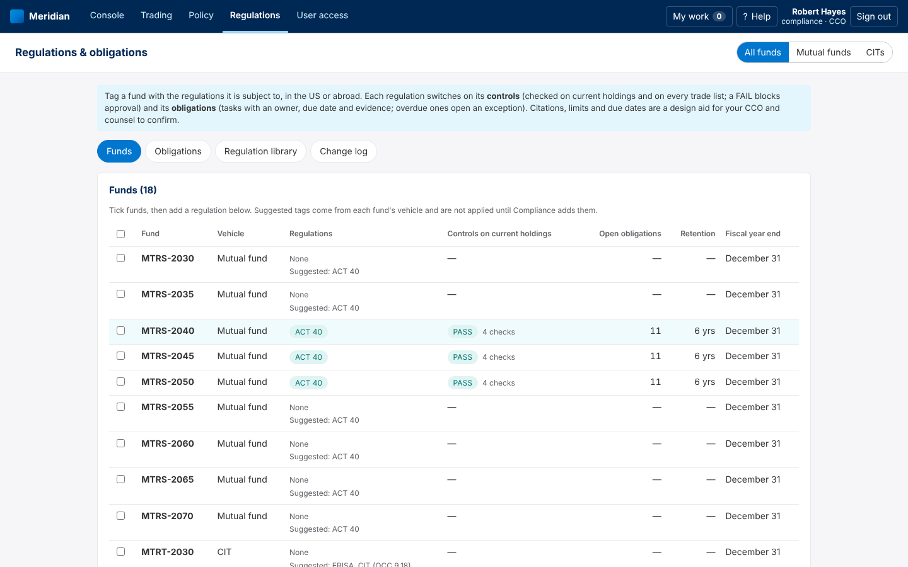
*Image: `reg-02-funds.png`*

### 12.2 See a fund's controls, required people and obligations

*Image: `reg-03-fund-detail.png`*

1. Click a fund: its regulations, **Controls on current holdings** (PASS/WARN/FAIL with measured value and citation), **People these regulations require** (unfilled ones in red), record retention and open obligations.
2. The same controls run on every trade preview and trade list for the fund (10.7).

### 12.3 Work the obligations

*Image: `reg-04-obligations.png`*

1. Click **Obligations**. Counters show open, overdue, due in 30 days and done; filter by status or regulation. Overdue rows are red.
2. Click an obligation.

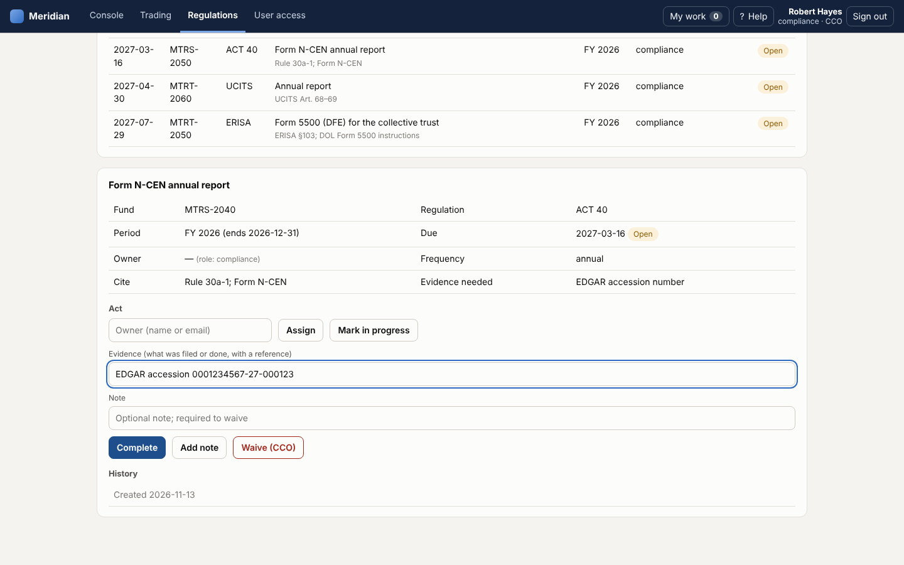
*Image: `reg-05-task.png`*

3. Click **Assign** for an owner, **Mark in progress**, **Add note**, or **Complete** with the evidence (e.g. the EDGAR accession number). Completing a recurring obligation creates the next period's.
4. **Waive (CCO)** is for the Chief Compliance Officer only, with a note.

**You're done when** the obligation shows its new status. An obligation not done by its due date opens an exception case once (Console → **Exceptions**).

### 12.4 Library and change log

*Image: `reg-06-library.png`*

- **Regulation library**: every regulation with its controls, obligations (frequency, due days, owner, citation), required people and retention, grouped US and international.
- **Change log**: every tag, removal and obligation action from the governance ledger.

---

## 13. Not built yet
Ask Meridian (ledger Q&A) · kill switch and autonomy controls · KPI view · replay of an approver's screen · due diligence workflow · CMA forecast-vs-realized · custom sell-down calculations · derivatives, in-kind redemptions, mandates, margin and capital calls (doc 17 Phase F) · Charles River API and results coming back automatically.

---

## Appendix A — Approval checklist
- [ ] I read the rationale and the dissent.
- [ ] Compliance shows PASS, or exceptions are approved.
- [ ] I understand the largest three changes and why.
- [ ] The "what would change the view" conditions are not already triggered.
- [ ] For trades: *Off target* and the gaps move the way I intended, cash after is not negative, and compliance after is PASS.
- [ ] My reason is recorded.

## Appendix B — Glossary
**SAA** strategic asset allocation · **CMA** capital market assumptions · **PC** portfolio construction · **CRO agent** neutral risk-assessor agent · **CIO agent** ensemble decision agent · **IPS** investment policy statement · **DR** decision record · **Look-through** aggregation of underlying fund holdings · **Borda count** ranked-vote scoring · **VaR 95** loss not exceeded with 95% confidence · **Active VaR** VaR of positions relative to the benchmark · **Spread duration** sensitivity to credit spreads · **CIT** collective investment trust · **TA** transfer agent · **pp** percentage points · **Off target** share of a fund that would have to move to match a mix exactly · **Gap** weight minus target · **Tranche** one dated slice of an order · **Tilt** a deliberate over- or underweight · **Route** where an order is sent for execution or settlement · **Shadow mode** nothing is executed.

## Appendix C — Messages and what they mean
| Message | Why | What to do |
|---|---|---|
| Reason must be at least 10 characters / Give a reason of at least 10 characters | The reason box is too short | Write a fuller reason; watch the counter under the box |
| Tick the review box (or the approve button does nothing) | The **I reviewed…** box isn't ticked | Tick it, then click again |
| Segregation of duties | You already decided this vintage in another role, or you are deciding your own request | Ask another approver |
| Needs the portfolio manager role / Portfolio managers only | The action is PM-only (e.g. rebalance) | Prepare what you can; ask a PM |
| Recording an approval needs the Approver permission / "Your account doesn't have the Approver permission" | You have the PM or Risk workspace but not the Approver permission | Ask an admin to switch it on in User access (11.2) |
| Pick at least one vintage | Every vintage button is cleared on a glide-path or bulk change | Click the vintages you want, or **All** |
| No cashflows to invest | No **New** cashflows for that date and product line | Load them on **Cashflows**, or switch **All funds** at the top right |
| Choose a fund / Add at least one security | The setup is incomplete | Pick a fund; click **Add** on a security |
| Not enough cash (in the ticket) / Cash would go negative | Buys exceed the fund's uninvested cash | Add a sell or lower the buy (10.5 step 7) |
| Blocked by errors or a compliance FAIL | A fund breaks an IPS or regulation rule after the trades | Read the red box in the impact; make a new draft that fixes it |
| Outside the IPS bands | A glide-path change exceeds ±3pp per asset class or ±5pp equity | Make it smaller; larger changes need an IPS amendment |
| Your session has expired | 8 hours passed | See 1.7 |
